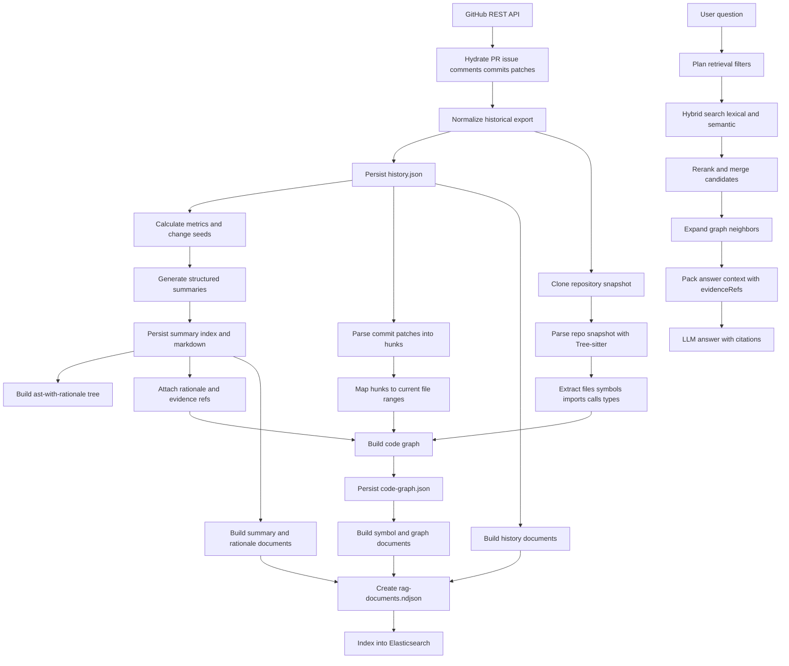
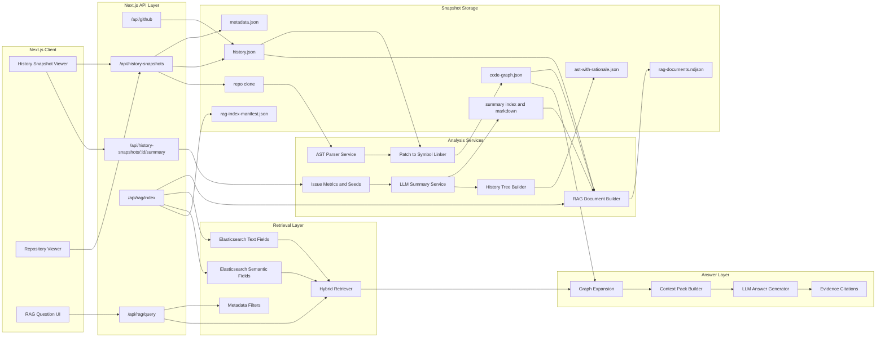
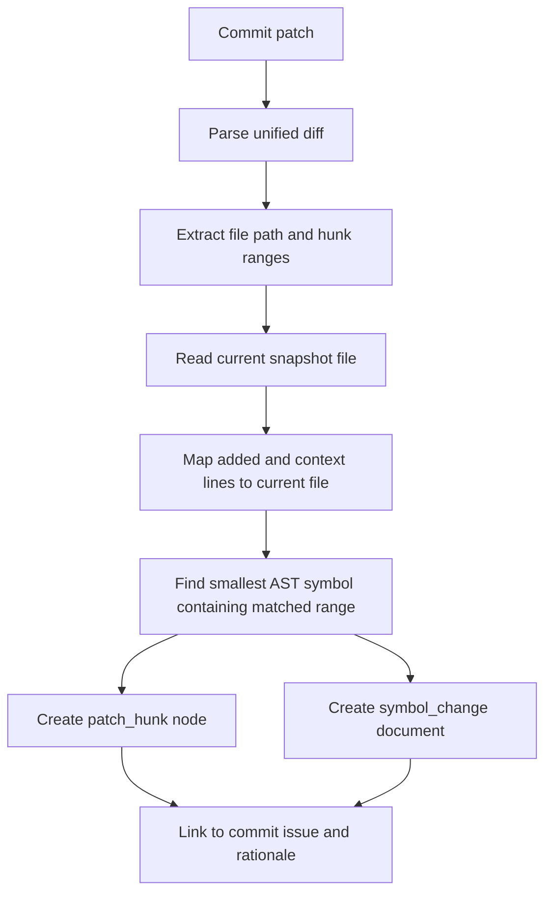
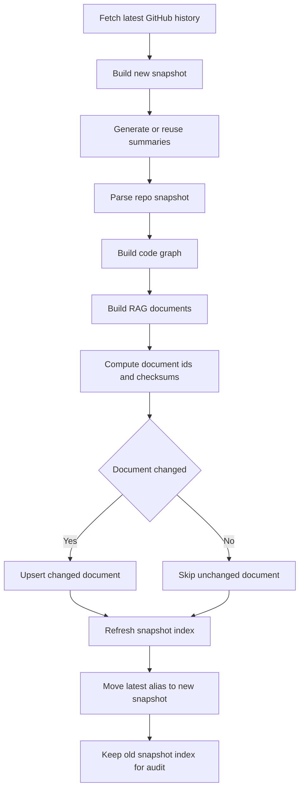

# RAG and AST Implementation Plan

Dokumen ini menjelaskan cara menambahkan Retrieval-Augmented Generation
dan AST/code graph di atas implementasi repository history analyzer yang sudah
ada sekarang.

Fokus desain ini adalah menjaga artefak saat ini tetap berguna:

- `history/history.json` tetap menjadi sumber historis utama.
- `history/summary/index.json` tetap menjadi sumber rationale terstruktur.
- `history/ast-with-rationale.json` tetap menjadi tree visual untuk viewer.
- Clone repo di `repo/` tetap menjadi sumber kode snapshot yang reproducible.

Layer baru yang disarankan adalah:

- `history/code-graph.json` untuk simbol kode dan relasi antar simbol.
- `history/rag-documents.ndjson` untuk dokumen kecil yang siap di-index.
- `history/rag-index-manifest.json` untuk metadata index, versi, dan checksum.

Dengan pemisahan ini, RAG tidak mengganti pipeline yang sudah ada. RAG hanya
menambahkan kemampuan query, retrieval, dan jawaban berbasis evidence.

## Current Baseline

Pipeline saat ini sudah punya fondasi yang kuat untuk RAG:

| Artefak | Status sekarang | Peran untuk RAG |
| --- | --- | --- |
| `history.json` | Berisi repo, fetchedAt, issues, discussions, commits, dan patches | Sumber dokumen historis dan filter metadata |
| `summary/index.json` | Berisi background, whatChanged, changeContrast, metrics, impact, rationale, evidenceRefs | Sumber rationale dan evidence trail |
| `summary/issue-<number>.md` | Markdown summary per issue | Dokumen naratif untuk retrieval |
| `ast-with-rationale.json` | Tree issue -> discussion -> commit -> change -> rationale | Visual tree dan navigasi, bukan AST bahasa formal |
| `repo/` | Clone repository snapshot | Sumber parsing AST/code graph |

Catatan penting: `ast-with-rationale.json` saat ini sebaiknya tetap dipahami
sebagai history tree yang diperkaya rationale. AST bahasa formal lebih baik
ditambahkan sebagai artefak baru agar nama, kontrak, dan viewer lama tidak ikut
berubah.

## Overall Methods



Metode di atas membuat pipeline menjadi dua fase besar:

1. **Ingestion and analysis**  
   Mengambil data GitHub, membuat snapshot, summary, history tree, AST/code
   graph, lalu menyiapkan dokumen retrieval.

2. **Retrieval and answer**  
   Menerima pertanyaan user, mencari dokumen relevan, memperluas konteks lewat
   graph, lalu meminta LLM menjawab dengan bukti yang bisa ditelusuri.

## Overall Architecture



Komponen baru yang perlu ditambahkan berada di `Analysis Services`,
`Retrieval Layer`, dan `Answer Layer`. Komponen lama tetap dipakai sebagai
source of truth.

## Proposed Data Contracts

### Code Graph Artifact

`history/code-graph.json` menyimpan AST formal dan relasi kode yang sudah
dinormalisasi ke bentuk graph.

Contoh shape:

```json
{
  "repo": "excalidraw/excalidraw",
  "snapshotId": "excalidraw-excalidraw-2026-05-09T14-24-11-800Z",
  "generatedAt": "2026-05-30T00:00:00.000Z",
  "parser": {
    "engine": "tree-sitter",
    "languages": ["typescript", "tsx", "javascript", "jsx"]
  },
  "nodes": [
    {
      "id": "symbol:packages/element/src/binding.ts:updateBoundPoint",
      "kind": "function",
      "name": "updateBoundPoint",
      "filePath": "packages/element/src/binding.ts",
      "startLine": 1760,
      "endLine": 1815,
      "signature": "export const updateBoundPoint = (...) => ...",
      "textPreview": "export const updateBoundPoint = ("
    }
  ],
  "edges": [
    {
      "from": "file:packages/element/src/binding.ts",
      "to": "symbol:packages/element/src/binding.ts:updateBoundPoint",
      "kind": "contains"
    },
    {
      "from": "patch:24a60b0:packages/element/src/binding.ts:0",
      "to": "symbol:packages/element/src/binding.ts:updateBoundPoint",
      "kind": "changes"
    }
  ]
}
```

Node yang disarankan:

| Node kind | Isi |
| --- | --- |
| `repo` | Repository dan snapshot |
| `file` | Path, language, size, checksum |
| `symbol` | Function, class, method, interface, type, variable export |
| `import` | Import source dan imported names |
| `call` | Caller, callee text, resolved target bila tersedia |
| `patch_hunk` | Commit SHA, filename, old/new range, patch excerpt |
| `issue` | Issue number, title, createdAt |
| `commit` | SHA, message, author, committedAt |
| `rationale` | Change, rationale, evidenceSource, evidenceRefs |

Edge yang disarankan:

| Edge kind | Dari | Ke |
| --- | --- | --- |
| `contains` | repo/file | file/symbol |
| `imports` | file | file/module |
| `calls` | symbol | symbol/call target |
| `changes` | patch_hunk/commit | symbol/file |
| `belongs_to` | commit | issue |
| `explained_by` | commit/symbol/patch_hunk | rationale |
| `evidenced_by` | rationale | discussion/commit/patch_hunk |

### RAG Documents

`history/rag-documents.ndjson` adalah dokumen kecil untuk indexing. Satu baris
berisi satu dokumen retrieval.

Contoh:

```json
{"id":"rationale:10831:0","docType":"rationale","repo":"excalidraw/excalidraw","snapshotId":"excalidraw-excalidraw-2026-05-09T14-24-11-800Z","issueNumber":10831,"commitSha":"24a60b062145d6e8da4d97a7e5bd3cbb0bd8c06b","filePath":"packages/element/src/binding.ts","symbolIds":["symbol:packages/element/src/binding.ts:updateBoundPoint"],"title":"fix(editor): Multi-point arrow bound point update","text":"Multi-point arrow bound point update. Karena struktur kode dan logika pemilihan titik tidak memperhitungkan kasus panah multi-titik...","evidenceRefs":["patch:24a60b062145d6e8da4d97a7e5bd3cbb0bd8c06b:packages/element/src/binding.ts"],"graphRefs":["symbol:packages/element/src/binding.ts:updateBoundPoint"]}
```

Jenis dokumen yang disarankan:

| docType | Sumber | Tujuan retrieval |
| --- | --- | --- |
| `issue` | `history.json` | Pertanyaan tentang PR atau issue |
| `discussion` | `history.json` | Pertanyaan tentang alasan dari komentar manusia |
| `commit` | `history.json` | Pertanyaan tentang perubahan per commit |
| `patch_hunk` | `history.json` dan diff parser | Pertanyaan teknis spesifik kode |
| `summary` | `summary/index.json` | Pertanyaan naratif level PR |
| `rationale` | `whatChanged` dan `changeContrast` | Pertanyaan kenapa perubahan dilakukan |
| `symbol` | `code-graph.json` | Pertanyaan tentang fungsi, class, object, type |
| `symbol_change` | join patch hunk + symbol + rationale | Pertanyaan hubungan kode dan histori |

## Elasticsearch Indexing Strategy

Elasticsearch sebaiknya dipakai sebagai retrieval engine, bukan sebagai graph
database utama. Graph relasi tetap disimpan eksplisit di `code-graph.json`,
sedangkan Elasticsearch menyimpan dokumen yang mudah dicari.

Mapping konseptual:

```json
{
  "mappings": {
    "properties": {
      "id": { "type": "keyword" },
      "docType": { "type": "keyword" },
      "repo": { "type": "keyword" },
      "snapshotId": { "type": "keyword" },
      "issueNumber": { "type": "integer" },
      "commitSha": { "type": "keyword" },
      "filePath": { "type": "keyword" },
      "symbolIds": { "type": "keyword" },
      "title": { "type": "text" },
      "text": { "type": "text" },
      "semanticText": { "type": "semantic_text" },
      "evidenceRefs": { "type": "keyword" },
      "graphRefs": { "type": "keyword" },
      "createdAt": { "type": "date" },
      "generatedAt": { "type": "date" }
    }
  }
}
```

Jika `semantic_text` dipakai, pastikan cluster dan inference endpoint-nya sudah
sesuai. Jika belum, field semantic bisa diganti sementara dengan embedding yang
dibuat aplikasi dan disimpan sebagai vector field eksplisit.

Retrieval sebaiknya hybrid:

- **Keyword/filter retrieval** untuk repo, snapshot, issue number, commit SHA,
  filename, symbol name, dan evidenceRefs.
- **Lexical retrieval** untuk exact wording dari code, patch, dan title.
- **Semantic retrieval** untuk pertanyaan natural language seperti
  "kenapa multi-point arrow binding diubah".
- **Reranking atau reciprocal rank fusion** untuk menggabungkan hasil lexical
  dan semantic.

Alasan tidak memakai vector-only:

- Query kode sering membutuhkan exact match.
- Nama fungsi, path, SHA, dan issue number tidak boleh hilang karena embedding.
- Rationale butuh semantic search, tetapi evidence tetap harus exact dan
  audit-friendly.

## AST Parsing Strategy

Untuk TypeScript, JavaScript, TSX, dan JSX, strategi paling realistis adalah:

1. Parse file snapshot menggunakan Tree-sitter.
2. Gunakan query capture untuk mengambil function, class, method, interface,
   type alias, exported const, import, dan call expression.
3. Simpan range line/column setiap capture.
4. Buat symbol id deterministik dari file path, scope, symbol kind, dan name.
5. Hubungkan patch hunk ke symbol terkecil yang mencakup range perubahan.
6. Tambahkan TypeScript compiler API nanti bila butuh resolusi import/call yang
   lebih akurat.

Contoh symbol id:

```text
symbol:<filePath>:<scopePath>:<kind>:<name>
```

Contoh:

```text
symbol:packages/element/src/binding.ts:module:function:updateBoundPoint
```

Untuk update jangka panjang, simpan dua jenis id:

- `stableId`: berdasarkan path, scope, kind, dan name.
- `contentId`: berdasarkan checksum potongan source symbol.

`stableId` membantu melacak simbol walau isi berubah. `contentId` membantu
mendeteksi apakah simbol benar-benar berubah.

## Patch to AST Linking

Relasi paling penting untuk RAG adalah menghubungkan histori ke kode sekarang:



Jika hunk tidak bisa dipetakan ke simbol:

- fallback ke node `file`;
- tetap simpan patch excerpt;
- tandai `linkConfidence` sebagai `low`;
- jangan memaksa LLM menyimpulkan nama fungsi.

Contoh confidence:

| confidence | Kondisi |
| --- | --- |
| `high` | Hunk range jatuh di dalam satu symbol yang jelas |
| `medium` | Hunk menyentuh beberapa symbol di file yang sama |
| `low` | Hunk hanya bisa dipetakan ke file |

## Query Flow

Ketika user bertanya, misalnya:

```text
Kenapa updateBoundPoint berubah dan PR mana yang memengaruhinya?
```

Flow retrieval:

1. Deteksi entity: `updateBoundPoint` kemungkinan symbol.
2. Cari exact `symbol.name:updateBoundPoint`.
3. Ambil `symbol_change` yang terhubung ke symbol tersebut.
4. Ambil patch hunk, commit, issue, summary, dan rationale yang linked.
5. Jalankan semantic search tambahan untuk "kenapa berubah".
6. Merge hasil lexical dan semantic.
7. Expand graph 1 sampai 2 hop:
   - symbol -> patch_hunk
   - patch_hunk -> commit
   - commit -> issue
   - commit -> rationale
   - rationale -> evidenceRefs
8. Susun context pack.
9. LLM menjawab dengan menyebut issue, commit, file, symbol, dan evidence.

Jawaban ideal tidak hanya berbunyi:

```text
Fungsi itu diubah untuk memperbaiki binding.
```

Tetapi:

```text
`updateBoundPoint` di `packages/element/src/binding.ts` berubah pada commit
`24a60b0...` dalam PR `#10831`. Evidence patch menunjukkan indeks start/end
diubah dan pemilihan `otherFocusPointOrArrowPoint` dibuat conditional terhadap
`arrow.points.length`. Rationale summary menjelaskan bahwa kasus arrow dengan
lebih dari dua titik sebelumnya bisa memilih titik yang tidak relevan.
```

## Context Pack Shape

Context yang dikirim ke LLM sebaiknya kecil dan evidence-first.

```json
{
  "question": "Kenapa updateBoundPoint berubah?",
  "repo": "excalidraw/excalidraw",
  "snapshotId": "excalidraw-excalidraw-2026-05-09T14-24-11-800Z",
  "entities": {
    "symbols": ["updateBoundPoint"],
    "files": ["packages/element/src/binding.ts"],
    "issues": [10831],
    "commits": ["24a60b062145d6e8da4d97a7e5bd3cbb0bd8c06b"]
  },
  "evidence": [
    {
      "type": "patch_hunk",
      "ref": "patch:24a60b062145d6e8da4d97a7e5bd3cbb0bd8c06b:packages/element/src/binding.ts",
      "text": "Patch excerpt..."
    },
    {
      "type": "rationale",
      "ref": "rationale:10831:0",
      "text": "Karena struktur kode dan logika pemilihan titik..."
    }
  ],
  "graph": [
    {
      "from": "symbol:packages/element/src/binding.ts:module:function:updateBoundPoint",
      "to": "patch:24a60b062145d6e8da4d97a7e5bd3cbb0bd8c06b:packages/element/src/binding.ts",
      "kind": "changed_by"
    }
  ]
}
```

Prompt answer layer perlu memberi aturan:

- Jawab hanya dari context yang tersedia.
- Jika evidence tidak cukup, sebutkan bagian yang belum pasti.
- Sebutkan issue, commit, file, dan symbol jika tersedia.
- Jangan membuat alasan baru di luar rationale/evidence.
- Prioritaskan evidence source: human discussion, commit message, patch excerpt,
  lalu inferred.

## Incremental Update Flow

Karena data history bersifat hidup, indexing harus versioned.



Rekomendasi index naming:

```text
repo-history-<repo-slug>-<snapshot-id>
repo-history-<repo-slug>-latest
```

`latest` sebaiknya alias, bukan index fisik. Dengan begitu UI bisa memilih:

- latest snapshot untuk pertanyaan harian;
- snapshot spesifik untuk audit historis;
- perbandingan antar snapshot bila diperlukan.

## Integration Points in Current Codebase

| Area | File saat ini | Perubahan yang disarankan |
| --- | --- | --- |
| Snapshot storage | `app/history-viewer/server/SnapshotWorkspaceStore.ts` | Tambahkan read/write untuk `code-graph.json`, `rag-documents.ndjson`, dan manifest |
| Summary generation | `app/history-viewer/server/SnapshotSummaryService.ts` | Setelah `ast-with-rationale.json`, panggil code graph dan RAG document builder |
| Issue analysis | `app/history-viewer/lib/issueAnalysis.ts` | Pertahankan heuristic seeds; nanti enrich dengan AST-derived seeds |
| History tree | `app/history-viewer/lib/historyTree.ts` | Tetap untuk viewer; jangan dijadikan AST formal |
| API summary | `app/api/history-snapshots/[snapshotId]/summary/route.ts` | Bisa trigger artifact generation lanjutan |
| New indexing API | belum ada | Tambahkan `POST /api/rag/index` untuk index snapshot |
| New query API | belum ada | Tambahkan `POST /api/rag/query` untuk retrieval dan answer |

## Implementation Phases

### Phase 1: RAG over existing artifacts

Target: query sudah bisa menjawab dari `history.json`, `summary/index.json`, dan
`ast-with-rationale.json` tanpa AST formal.

Output:

- `rag-documents.ndjson`
- Elasticsearch index
- `/api/rag/query`

Dokumen yang dibuat:

- issue
- discussion
- commit
- patch_hunk sederhana
- summary
- rationale

Ini fase paling cepat karena semua sumber datanya sudah ada.

### Phase 2: Tree-sitter symbol extraction

Target: setiap file repo snapshot punya daftar symbol.

Output:

- `code-graph.json` dengan node `file` dan `symbol`
- dokumen `symbol`

Scope awal:

- `.ts`
- `.tsx`
- `.js`
- `.jsx`

Capture awal:

- function declaration
- arrow function assigned to const
- class declaration
- method definition
- interface declaration
- type alias
- import declaration
- export declaration

### Phase 3: Patch to symbol linking

Target: patch hunk bisa menunjuk function/object/type yang berubah.

Output:

- edge `changes`
- dokumen `symbol_change`
- `linkConfidence`

Ini fase yang membuat RAG terasa kuat karena pertanyaan user biasanya mengarah
ke "fungsi apa yang berubah dan kenapa".

### Phase 4: Graph expansion in retrieval

Target: hasil Elasticsearch tidak langsung dikirim ke LLM, tetapi diperluas
berdasarkan relasi graph.

Contoh expansion:

- symbol -> patch_hunk -> commit -> issue -> rationale
- file -> import -> related file
- commit -> changed symbols
- rationale -> evidenceRefs

### Phase 5: AST-derived change contrast

Target: heuristic di `issueAnalysis.ts` dinaikkan dari patch regex menjadi
signal AST.

Contoh:

| Current seed | AST-derived signal |
| --- | --- |
| `logic` | conditional node berubah |
| `algorithm` | loop, call chain, reducer, sort, filter berubah |
| `struktur kode` | import/export/type/interface berubah |
| `behavior` | handler/render/visibility branch berubah |
| `functions` | signature, parameter, return, helper boundary berubah |

Pada fase ini LLM tetap tidak menentukan aspek. LLM hanya mengisi narasi
`before`, `after`, dan `rationale`, seperti pola saat ini.

## Best Practices

- Jangan index file besar sebagai satu dokumen. Pecah menjadi symbol, hunk,
  commit, issue, dan rationale.
- Jangan hanya memakai embedding. Tetap gunakan exact filter dan lexical search.
- Jangan overwrite snapshot lama. Buat index versioned dan alias latest.
- Jangan campur `ast-with-rationale.json` dengan AST formal. Buat
  `code-graph.json`.
- Jangan biarkan LLM membuat citation sendiri. Citation harus berasal dari
  `evidenceRefs`, commit SHA, file path, issue number, dan symbol id.
- Jangan menunggu AST sempurna untuk memulai RAG. Phase 1 bisa berjalan dari
  artefak sekarang.
- Simpan `linkConfidence` saat menghubungkan patch ke symbol.
- Simpan checksum dokumen agar update bisa incremental.

## References

- Elastic semantic text field:
  https://www.elastic.co/docs/reference/elasticsearch/mapping-reference/semantic-text
- Elastic reciprocal rank fusion:
  https://www.elastic.co/docs/reference/elasticsearch/rest-apis/reciprocal-rank-fusion
- Tree-sitter query syntax:
  https://tree-sitter.github.io/tree-sitter/using-parsers/queries/1-syntax.html
