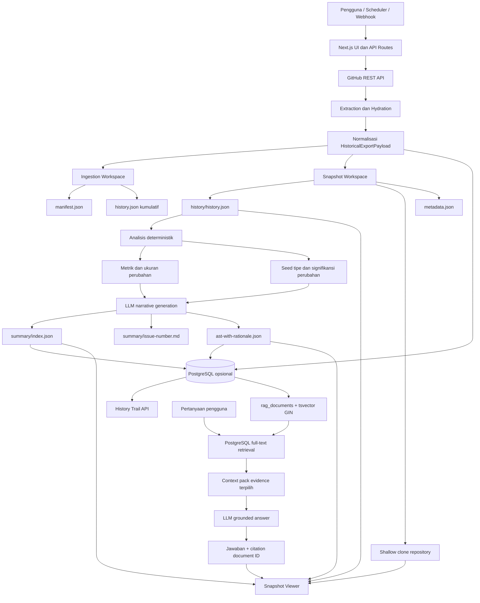
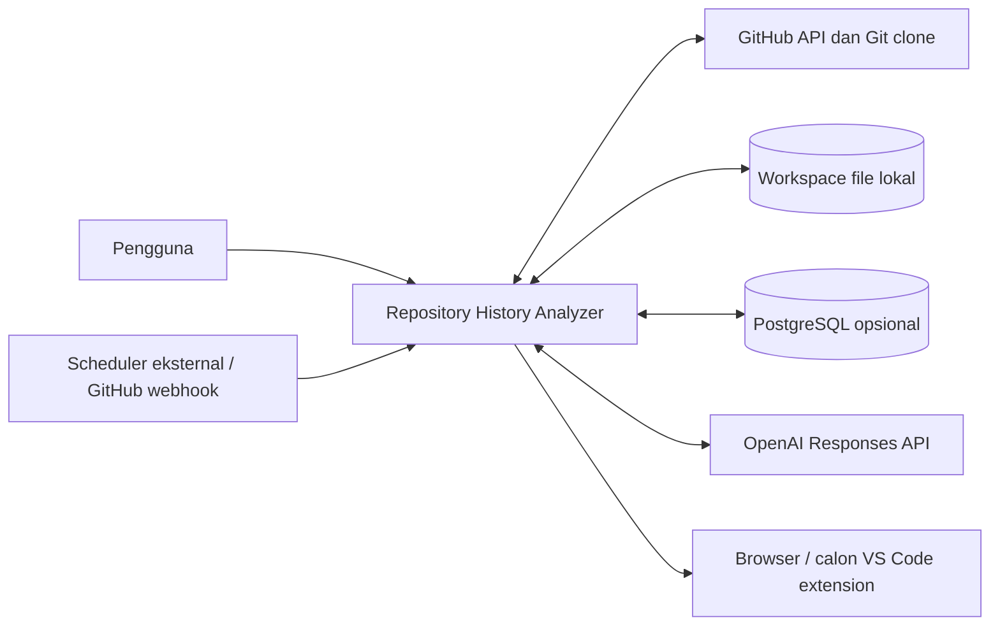
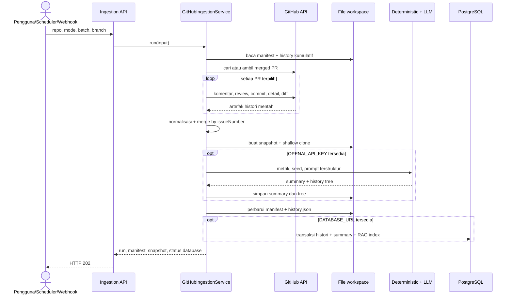
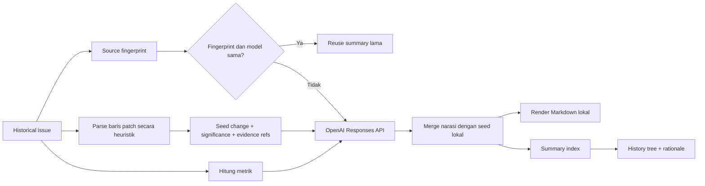
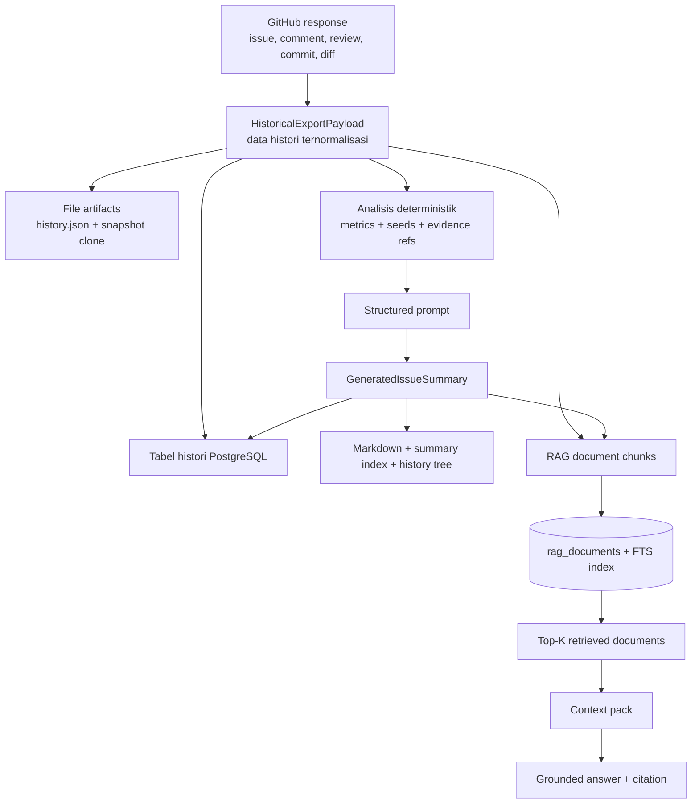
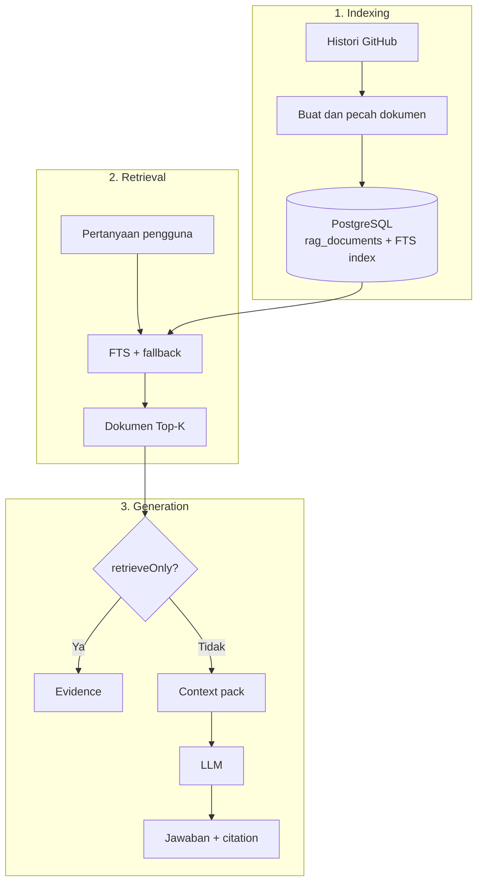
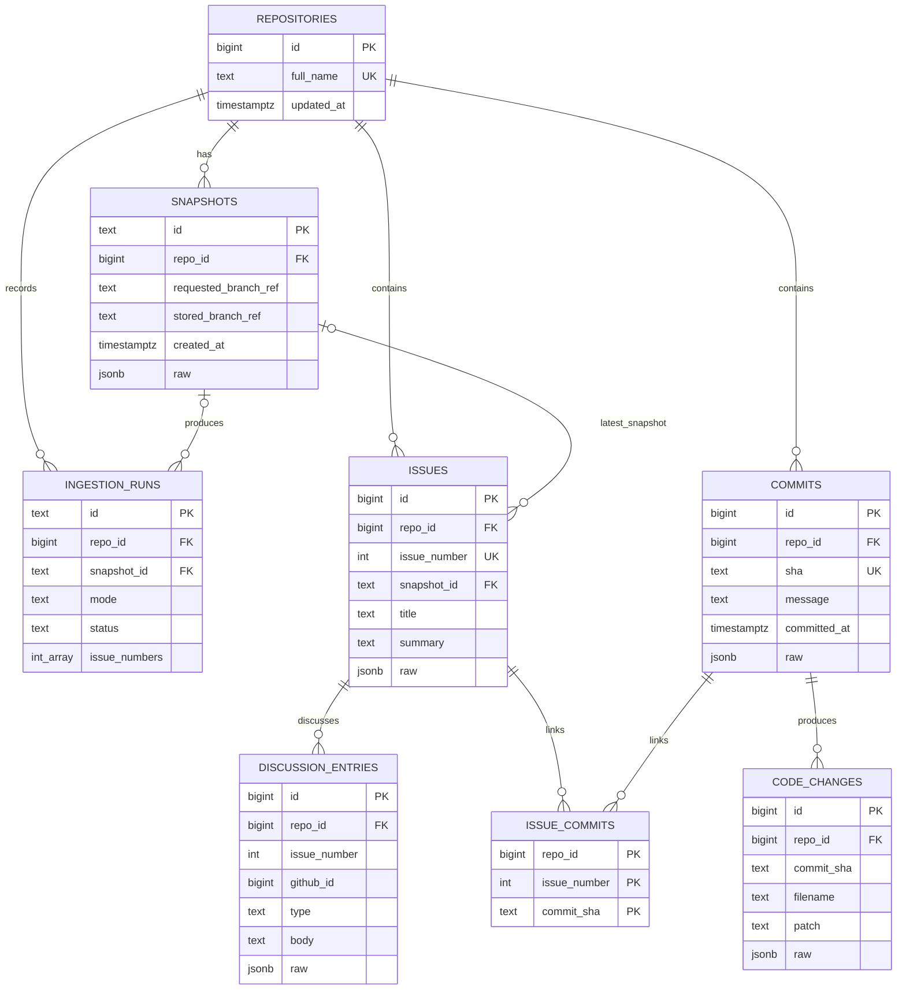
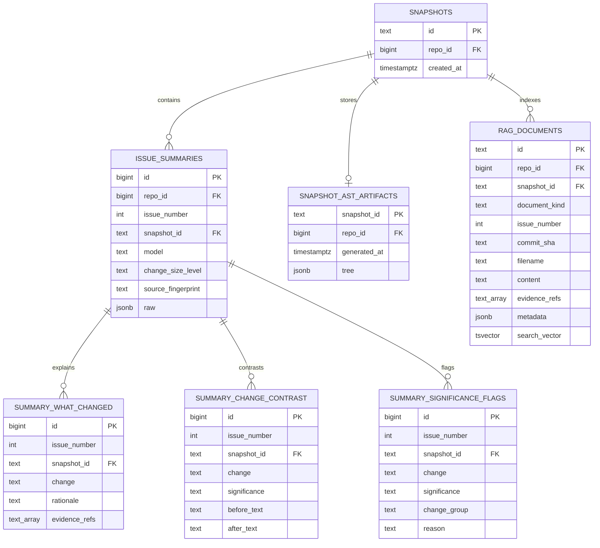

# Catatan Sinkronisasi Implementasi untuk Laporan Thesis

Dokumen ini adalah **living document** yang menghubungkan implementasi aktual
Repository History Analyzer dengan materi laporan thesis. Gunakan dokumen ini
sebagai sumber teknis sebelum menulis atau memperbarui bagian metodologi,
perancangan, implementasi, pengujian, dan keterbatasan sistem.

> Prinsip sinkronisasi: klaim di laporan harus mengikuti kode yang sudah ada,
> bukan hanya rencana pada dokumen desain.

## 1. Baseline Dokumen

| Item | Nilai |
| --- | --- |
| Tanggal audit | 27 Oktober 2026 (Asia/Makassar) |
| Branch | `master` |
| Commit acuan | `121a7f0` — `feat: Implement PostgresHistoryStore for managing historical data and ingestion results` |
| Kondisi working tree | Implementasi RAG (service, API, UI, schema, dan tipe) serta dokumen sinkronisasi ini masih berupa perubahan lokal yang belum di-commit; perubahan formatting lama pada `GitHubIngestionService.ts` tetap dipertahankan |
| Framework | Next.js `16.2.4`, React `19.2.4`, TypeScript `5` |
| Database | PostgreSQL melalui package `pg`; penggunaan database bersifat opsional melalui `DATABASE_URL` |
| Model summary default | `gpt-5-mini` melalui OpenAI Responses API |
| Verifikasi baseline | `npm run lint`, `npx tsc --noEmit`, dan `npm run build` lulus; indexing dan retrieval diuji pada branch Neon sementara |

Dokumen perlu diperbarui apabila commit acuan, kontrak data, algoritma, endpoint,
atau hasil pengujian berubah.

## 2. Ringkasan Sistem untuk Thesis

Repository History Analyzer adalah aplikasi web untuk mengumpulkan dan
menyajikan jejak evolusi perangkat lunak dari pull request GitHub. Sistem
menghubungkan empat jenis bukti utama:

1. deskripsi pull request;
2. diskusi issue dan review;
3. commit yang menjadi bagian dari pull request; dan
4. patch perubahan kode per commit.

Data tersebut dinormalisasi menjadi histori terstruktur, disimpan sebagai
snapshot yang dapat dibuka kembali, dianalisis secara deterministik, lalu dapat
diperkaya dengan ringkasan berbasis LLM. Hasil akhirnya ditampilkan sebagai
tree mapping, timeline evolusi, repository viewer, perbandingan diff, dan
history-trail API untuk integrasi eksternal.

Tujuan teknis implementasi saat ini adalah membantu pengembang menelusuri
hubungan antara **perubahan kode**, **keputusan yang mendasarinya**, dan
**evidence** yang mendukung keputusan tersebut.

### 2.1 Capaian implementasi per subsistem

1. **Akuisisi data:** proxy GitHub, pencarian merged PR, lazy hydration pada
   UI, serta ingestion server untuk issue, discussion, review, commit, file,
   dan patch.
2. **Manajemen histori:** export payload, workspace kumulatif, manifest run,
   snapshot, dan shallow clone repository.
3. **Analisis:** metrik perubahan, change size, change kind/significance,
   evidence reference, summary LLM terstruktur, dan reuse summary.
4. **Penyimpanan:** artefak JSON/Markdown pada filesystem serta 14 tabel
   PostgreSQL opsional, termasuk full-text RAG index.
5. **Penyajian:** issue journey, comparator, collapsible tree, timeline,
   repository viewer, rationale, significance, dan panel tanya jawab RAG.
6. **Integrasi:** endpoint ingestion/webhook, database query, RAG index/query,
   serta history-trail API untuk client eksternal.

Yang belum menjadi capaian runtime adalah AST parser formal, code graph,
semantic/vector retrieval, scheduler internal, automated test suite, dan VS
Code extension client.

## 3. Status Fitur Aktual

Legenda:

- **Selesai**: tersedia pada kode dan masuk dalam alur aplikasi.
- **Parsial**: tersedia, tetapi memiliki batas implementasi penting.
- **Rencana**: baru berupa desain atau dokumentasi, belum ada pada runtime.

| Fitur | Status | Bukti implementasi / catatan |
| --- | --- | --- |
| Pengambilan issue/PR GitHub | Selesai | `GitHubHistoryApi.ts`, `/api/github` |
| Filter merged PR dan rentang tanggal pada UI | Selesai | `app/page.tsx` |
| Hydration komentar, review, commit, file, dan patch | Selesai | `GitHubHistoryApi.ts`, `GitHubIngestionService.ts` |
| Export `history.json` | Selesai | `app/page.tsx` dan `IngestionWorkspaceStore.ts` |
| Snapshot histori dan clone repository | Selesai | `SnapshotWorkspaceStore.ts` |
| Ingestion bertahap: `backfill`, `forward`, `issue` | Parsial | Ketiga mode tersedia, tetapi cursor `forward.lastMergedAt` belum digunakan untuk query dan nilainya masih berasal dari `issue.createdAt` |
| Endpoint trigger ingestion | Selesai | `POST /api/ingestion/trigger` dapat dipanggil manual atau oleh scheduler eksternal |
| Scheduler/cron internal | Rencana | Belum ada penjadwal bawaan aplikasi; jadwal harus disediakan platform deployment atau layanan eksternal |
| Trigger dari merged pull request webhook | Parsial | `POST /api/webhook`; proses masih sinkron dan belum memverifikasi signature HMAC GitHub |
| Metrik perubahan deterministik | Selesai | `issueAnalysis.ts` |
| Klasifikasi ukuran perubahan | Selesai | `classifyChangeSize()` |
| Klasifikasi tipe/signifikansi perubahan | Selesai, heuristik | `inferChangeContrastSeeds()` dan `changeSignificanceRules.ts` |
| Ringkasan PR berbasis LLM | Selesai | `SnapshotSummaryService.ts` |
| Reuse summary yang sumbernya tidak berubah | Selesai | `sourceFingerprint`, model, dan `reusedFromGeneratedAt` |
| Rationale dengan evidence reference | Selesai | `whatChanged`, `changeContrast`, `evidenceRefs` |
| History tree dengan rationale | Selesai | `historyTree.ts`, `ast-with-rationale.json` |
| AST formal bahasa pemrograman | Rencana | `ast-with-rationale.json` saat ini adalah history tree, bukan syntax tree formal |
| Tree mapping interaktif | Selesai | `HistoryCollapsibleTree.tsx` menggunakan D3 |
| Timeline evolusi | Selesai | `EvolutionTimelineViewer.tsx` |
| Repository viewer dan fokus patch | Selesai | `SnapshotRepoViewer.tsx` |
| PostgreSQL persistence | Selesai, opsional | `PostgresHistoryStore.ts` |
| Significance flags API | Selesai | `GET /api/database/significance-flags` |
| Backend API untuk VS Code extension | Selesai | `GET /api/extension/history-trail` |
| VS Code extension client | Rencana | Baru ada persiapan API dan dokumentasi |
| RAG berbasis PostgreSQL full-text | Selesai (MVP) | Chunking, GIN full-text index, retrieval, context packing, grounded answer, dan citation tersedia |
| RAG index/query API | Selesai | `POST /api/rag/index` dan `POST /api/rag/query` |
| RAG question UI | Selesai | `RagQuestionPanel.tsx`; mendukung retrieve-only dan grounded answer |
| Semantic/vector atau hybrid retrieval | Rencana | MVP masih lexical full-text + substring fallback |
| Code graph dan AST formal untuk retrieval | Rencana | Masih mengikuti rancangan `docs/2026-05-30-rag-ast-implementation.md` |
| Automated test suite | Belum tersedia | Belum ditemukan unit, integration, atau end-to-end test di repository |

## 4. Arsitektur Aktual

Arsitektur aplikasi memakai Next.js sebagai presentation layer sekaligus
backend-for-frontend. Proses yang membutuhkan akses filesystem, Git, database,
atau secret dijalankan pada server melalui API route dan service ber-runtime
Node.js.

### 4.1 Diagram komponen dan aliran utama



### 4.2 Konteks sistem



Batas sistem berada pada aplikasi Next.js. GitHub merupakan sumber data
eksternal, OpenAI menyediakan generasi naratif, sedangkan filesystem dan
PostgreSQL adalah penyimpanan yang dikelola aplikasi. VS Code extension belum
menjadi bagian implementasi; saat ini aplikasi baru menyediakan API yang dapat
dikonsumsi extension tersebut.

### 4.3 Jalur operasi yang tersedia

| Jalur | Pemicu | Proses utama | Keluaran |
| --- | --- | --- | --- |
| Eksplorasi interaktif | Pengguna pada halaman utama | UI memanggil proxy GitHub, memuat detail PR secara lazy, dan membentuk payload di browser | Tampilan issue/commit/diff, export JSON, atau snapshot manual |
| Ingestion otomatis | `POST /api/ingestion/trigger` atau webhook merged PR | Service memilih PR, melakukan hydration, merge histori kumulatif, membuat snapshot, lalu menjalankan summary/persistence bila dikonfigurasi | Manifest, `history.json`, snapshot, summary, PostgreSQL, dan indeks RAG |
| Analisis snapshot | Pengguna membuka `/history-snapshots/:id` | Server membaca histori, clone repository, summary, dan history tree dari snapshot | Tree, timeline, repository viewer, diff, dan rationale |
| Tanya jawab RAG | Pertanyaan pada `RagQuestionPanel` | PostgreSQL retrieval memilih dokumen, service menyusun context, lalu LLM menghasilkan jawaban bila bukan retrieve-only | Evidence retrieval atau grounded answer beserta citation |
| Integrasi eksternal | Client memanggil history-trail API | PostgreSQL menggabungkan file, commit, issue, summary, rationale, contrast, dan significance | Data histori terstruktur untuk calon VS Code extension |

Jalur interaktif dan ingestion otomatis sama-sama menghasilkan kontrak
`HistoricalExportPayload`, tetapi implementasinya berbeda. Jalur interaktif
menyimpan state sementara di browser dan melakukan hydration sesuai aksi
pengguna. Jalur otomatis seluruhnya berjalan di server dan menyimpan progres
antar-run melalui manifest.

### 4.4 Keputusan desain utama

| Keputusan | Implementasi | Alasan dan konsekuensi |
| --- | --- | --- |
| Backend-for-frontend | Next.js UI dan API route berada dalam satu project | Kontrak UI–server sederhana, tetapi endpoint yang terbuka harus diberi autentikasi sebelum production |
| Incremental ingestion | Mode `backfill`, `forward`, dan `issue` dengan manifest | Menghindari pemrosesan ulang seluruh repository; cursor forward saat ini belum optimal |
| Dual persistence | Snapshot file selalu tersedia; PostgreSQL aktif bila `DATABASE_URL` ada | Aplikasi tetap dapat berjalan tanpa database, tetapi data dapat terduplikasi pada dua media |
| Evidence-first traceability | Issue number, commit SHA, filename, dan `evidenceRefs` dipertahankan lintas proses | Narasi dan visualisasi dapat ditelusuri kembali ke sumber |
| Hybrid deterministic–generative | Aturan lokal menetapkan metrik/label; LLM menulis narasi | Mengurangi ketergantungan klasifikasi pada output probabilistik |
| Structured LLM output | Responses API memakai JSON Schema; Markdown dirender lokal | Bentuk hasil lebih konsisten dan mudah dipersistenkan |
| Snapshot-oriented analysis | Histori, clone, summary, dan tree dikelompokkan berdasarkan snapshot ID | Mendukung reproduksi tampilan, tetapi clone `depth 1` bukan histori Git lengkap |
| Lexical RAG | PostgreSQL FTS + GIN + substring fallback | Sederhana dan audit-friendly, tetapi belum menangkap kesamaan semantik lintas istilah/bahasa |

### 4.5 Pembagian layer

| Layer | Tanggung jawab | Modul utama |
| --- | --- | --- |
| Presentation | Input repository, issue journey, snapshot detail, tree, timeline, diff, repository viewer | `app/page.tsx`, `app/history-viewer/components/*` |
| Client data access | Membentuk URL proxy dan memanggil API internal | `GitHubHistoryApi.ts` |
| API | Proxy GitHub, snapshot, summary, ingestion, webhook, database, extension | `app/api/**/route.ts` |
| Ingestion | Seleksi PR, hydration, merge payload, snapshot, summary, persistence | `GitHubIngestionService.ts` |
| Deterministic analysis | Metrik patch, ukuran perubahan, tipe dan signifikansi perubahan | `issueAnalysis.ts`, `changeSignificanceRules.ts` |
| Generative analysis | Narasi background, rationale, impact, dan verification | `SnapshotSummaryService.ts` |
| RAG indexing | Chunk issue, discussion, commit, patch, dan summary | `RagDocumentBuilder.ts` |
| RAG retrieval/generation | Full-text retrieval, context packing, grounded answer, dan validasi citation | `PostgresHistoryStore.ts`, `RagAnswerService.ts` |
| File persistence | Workspace ingestion dan artefak snapshot | `IngestionWorkspaceStore.ts`, `SnapshotWorkspaceStore.ts` |
| Relational persistence | Penyimpanan normalized history dan summary | `PostgresHistoryStore.ts` |

## 5. Alur Proses Aktual

### 5.1 Alur ingestion server

1. Input repository dinormalisasi menjadi format `owner/repo`.
2. Sistem memilih mode `backfill`, `forward`, atau `issue`.
3. Batch dibatasi pada 1–20 item; default-nya 3.
4. Untuk mode batch, sistem mencari merged pull request dengan GitHub Search
   API dan menghindari nomor issue yang sudah ada di manifest.
5. Setiap PR di-hydrate dengan issue comments, review comments, daftar commit,
   detail PR, dan diff per commit.
6. PR yang belum merged, tidak memiliki penanda pull request, atau tidak
   memiliki commit tidak dimasukkan ke payload historis.
7. Hasil baru digabungkan dengan `history.json` kumulatif berdasarkan
   `issueNumber`, kemudian diurutkan menggunakan `createdAt` terbaru.
8. Sistem membuat snapshot baru yang berisi histori dan shallow clone branch
   repository.
9. Jika `OPENAI_API_KEY` tersedia dan summary tidak dimatikan, sistem membuat
   atau memakai ulang summary per issue.
10. Manifest ingestion dan workspace lokal diperbarui.
11. Jika `DATABASE_URL` tersedia, payload, snapshot, run, summary, dan tree
    disimpan ke PostgreSQL dalam satu transaksi.

### 5.2 Mode ingestion

| Mode | Tujuan aktual | Catatan |
| --- | --- | --- |
| `backfill` | Melanjutkan pencarian dari `manifest.backfill.page` | Menyimpan `nextBackfillPage` dan `hasMore` |
| `forward` | Memindai dari halaman pertama dan mengambil PR yang belum pernah diproses | Field `forward.lastMergedAt` belum dipakai sebagai filter GitHub dan saat ini diisi dari `issue.createdAt`, bukan `merged_at` |
| `issue` | Memproses satu nomor PR secara langsung | Dipakai oleh webhook merged PR |

### 5.3 Sequence ingestion end-to-end



Kegagalan membuat snapshot atau mengambil data utama menggagalkan ingestion.
Sebaliknya, kegagalan summary dan persistence PostgreSQL ditangkap sebagai
pesan hasil sehingga snapshot/file workspace yang sudah berhasil dibuat tetap
dapat digunakan.

### 5.4 Alur summary



Pemisahan tanggung jawab yang perlu dijelaskan di thesis:

- Sistem lokal menentukan metrik, ukuran perubahan, label perubahan,
  significance, group, commit reference, dan patch reference.
- LLM mengisi narasi seperti background, before, after, rationale, impact,
  testing/verification, dan notes.
- Label/significance hasil aturan lokal tidak boleh diganti oleh LLM.
- Rationale diminta dalam struktur sebab–akibat–solusi:
  `Because [cause]. Therefore, [effect]. Solution: [solution].`
- Markdown dirender secara lokal dari template; LLM mengembalikan structured
  JSON, bukan dokumen Markdown akhir.

### 5.5 Flow data dan transformasi



Flow tersebut menunjukkan bahwa terdapat dua penggunaan LLM yang berbeda:

1. **summary generation**, yang menerima hasil analisis satu PR dan menghasilkan
   narasi terstruktur untuk artefak snapshot; dan
2. **RAG answer generation**, yang hanya menerima dokumen Top-K hasil retrieval
   untuk menjawab pertanyaan pengguna.

PostgreSQL bukan prompt itu sendiri. Database menyimpan dan mengambil evidence;
aplikasi yang mengubah evidence terpilih menjadi context prompt untuk LLM.

## 6. Data yang Diekstrak dan Dinormalisasi

### 6.1 Kontrak `HistoricalExportPayload`

```text
HistoricalExportPayload
├── repo
├── fetchedAt
├── exportType = "historical-evolution"
├── description
└── issues[]
    ├── issueNumber, title, url, createdAt, summary
    ├── discussion[]
    │   └── id, type, author, createdAt, url, body
    └── commits[]
        ├── sha, message, author, committedAt, url
        └── codeChanges[]
            └── filename, patch
```

Unit analisis utama pada implementasi sekarang adalah **merged pull request**
yang direpresentasikan sebagai `HistoricalIssueEntry`. Satu issue menghubungkan
diskusi, commit, dan patch yang akan dipakai untuk analisis selanjutnya.

### 6.2 Artefak file

```text
storage/
├── repo-ingestion/<repo-sanitized>/
│   ├── manifest.json
│   └── history.json
└── history-snapshots/<snapshot-id>/
    ├── metadata.json
    ├── repo/                         # shallow clone
    └── history/
        ├── history.json
        ├── ast-with-rationale.json
        └── summary/
            ├── index.json
            └── issue-<number>.md
```

Perbedaan penting:

- `repo-ingestion` menyimpan progres kumulatif dan manifest antar-run.
- `history-snapshots` menyimpan keadaan analisis pada satu waktu.
- Clone menggunakan `git clone --depth 1 --single-branch`; oleh karena itu
  clone adalah kondisi branch ketika snapshot dibuat, bukan checkout setiap
  commit historis yang dianalisis.

### 6.3 Artefak summary

Setiap summary issue menyimpan:

- background dan hubungan issue/PR;
- `whatChanged[]` beserta rationale dan evidence;
- `significanceFlags[]` hasil aturan deterministik;
- `changeContrast[]` berisi kondisi before/after;
- `changeSize` dan metrik;
- impact untuk user, system, dan developer;
- testing/verification dan notes;
- metadata model, waktu generasi, fingerprint sumber, dan reuse.

### 6.4 `ast-with-rationale.json`

Nama file ini dipertahankan untuk kompatibilitas implementasi, tetapi isi
aktualnya adalah **hierarchical history tree**, dengan struktur umum:

```text
repository
└── issues
    └── issue
        ├── discussion
        ├── commits
        │   └── commit
        │       ├── code change
        │       └── rationale
        └── summary
```

Dokumen thesis tidak boleh menyebut artefak ini sebagai AST formal dari source
code. Parser formal seperti Tree-sitter dan `code-graph.json` masih merupakan
rencana pengembangan.

### 6.5 Bentuk manifest ingestion dan metadata snapshot

```text
RepoIngestionManifest
├── repo, createdAt, updatedAt, batchSize
├── processedIssueNumbers[]
├── totalIssues, latestSnapshotId?
├── backfill
│   └── page, hasMore
├── forward
│   └── lastMergedAt
└── runs[]
    └── id, mode, status, startedAt, completedAt?,
        issueNumbers[], snapshotId?, generatedSummary, message?, error?

SnapshotRecord
├── id
├── repoName
├── requestedBranchRef
├── storedBranchRef
├── createdAt
├── snapshotDir
├── historyFile
└── repoDir
```

Manifest menggambarkan progres ingestion lintas eksekusi, sedangkan
`SnapshotRecord` menunjuk satu paket artefak yang immutable secara konseptual.
Pada implementasi saat ini, summary sebuah snapshot masih dapat dibuat ulang
dan menimpa artefak summary pada direktori snapshot yang sama.

### 6.6 Bentuk data summary

```text
GeneratedIssueSummary
├── issueNumber, title, relatedIssue, pullRequest, background
├── whatChanged[]
│   └── change, rationale, relatedCommitIds[], evidenceRefs[], evidenceSource
├── significanceFlags[]
│   └── change, significance, group, reason,
│       relatedCommitIds[], evidenceRefs[], evidenceSource
├── changeContrast[]
│   └── change, significance, group?, aspect?, before, after, rationale,
│       relatedCommitIds[], evidenceRefs[], evidenceSource
├── changeSize
│   └── level, rationale
├── metrics
│   └── discussionCount, commitCount, fileChangedCount, codeChangeCount,
│       additions, deletions, hunkCount
├── impact
│   └── user[], system[], developer[]
├── testingVerification[] dan notes[]
├── markdown dan markdownFile
└── generatedAt, model, sourceLastCommitAt?, sourceFingerprint?,
    reusedFromGeneratedAt?
```

`evidenceSource` dibatasi pada `discussion`, `commit_message`,
`patch_excerpt`, atau `inferred`. Field ini membedakan bukti eksplisit dari
kesimpulan yang dihasilkan melalui inferensi. Walaupun dinamai
`sourceFingerprint`, nilai aktualnya adalah hasil `JSON.stringify` dari sumber
issue, diskusi, commit, dan patch—bukan digest/hash kriptografis.

### 6.7 Bentuk data RAG

```text
RagDocumentInput
├── id = <snapshot>:<kind>:<source>:chunk-<n>
├── kind = issue | discussion | commit | patch | summary
├── issueNumber?, commitSha?, filename?
├── title, content
├── evidenceRefs[]
└── metadata

RagQueryResult
├── repo, snapshotId, question
├── answer? dan citations[]
│   └── documentId, claim
├── retrievedDocuments[]
│   └── RagDocumentInput + score + excerpt + repo + snapshotId
├── retrievalMethod
│   └── postgres-full-text | postgres-substring-fallback
└── model? dan generatedAt
```

ID dokumen mengandung snapshot sehingga chunk antar-snapshot tidak bertabrakan.
Citation memakai `documentId`, kemudian aplikasi membuang citation yang tidak
merujuk salah satu dokumen pada `retrievedDocuments`.

### 6.8 Identitas dan traceability lintas bentuk data

| Identifier | Asal | Dipertahankan pada | Fungsi traceability |
| --- | --- | --- | --- |
| `snapshotId` | Aplikasi saat snapshot dibuat | metadata, summary, tree, database, RAG document | Membatasi versi data yang dianalisis |
| `issueNumber` | GitHub PR/issue | payload, summary, database, RAG | Menghubungkan intent/diskusi dengan perubahan |
| `commitSha` | Git commit | payload, database, tree, timeline, RAG | Menghubungkan narasi dengan unit perubahan kode |
| `filename` | GitHub diff / clone | patch, database, repository viewer, extension API, RAG | Menavigasi histori pada file tertentu |
| `evidenceRefs` | Dibentuk aplikasi | summary, significance, RAG | Menunjuk `issue:`, `commit:`, `patch:`, atau discussion reference |
| `sourceFingerprint` | Serialisasi JSON dari input summary | summary index dan PostgreSQL | Menentukan apakah summary lama dapat dipakai ulang melalui perbandingan equality |

## 7. Metode Analisis Deterministik

### 7.1 Metrik issue

Metrik dihitung langsung dari payload dan patch:

| Metrik | Cara hitung |
| --- | --- |
| `discussionCount` | Jumlah issue comment dan review comment |
| `commitCount` | Jumlah commit dalam PR |
| `fileChangedCount` | Jumlah path file unik di seluruh commit |
| `codeChangeCount` | Jumlah pasangan commit–file |
| `additions` | Baris patch dengan awalan `+`, selain header `+++` |
| `deletions` | Baris patch dengan awalan `-`, selain header `---` |
| `hunkCount` | Baris patch dengan awalan `@@` |

### 7.2 Klasifikasi ukuran perubahan

Skor cakupan:

```text
weightedScope =
  (fileChangedCount × 3) +
  (commitCount × 2) +
  hunkCount +
  ceil((additions + deletions) / 40)
```

Aturan kelas:

- **large** apabila skor ≥ 24, atau file ≥ 8, atau commit ≥ 5, atau hunk ≥ 12;
- **medium** apabila skor ≥ 10, atau file ≥ 3, atau commit ≥ 2, atau hunk ≥ 4;
- **small** untuk kondisi selain itu.

Klasifikasi ini adalah aturan engineering yang eksplisit, bukan hasil training
model statistik.

### 7.3 Inferensi tipe perubahan

Patch dikelompokkan per hunk, lalu baris tambah/hapus dianalisis menggunakan
pola sintaks dan indentasi. Sistem dapat memberi label pada kategori berikut:

- kondisi loop dan control structure;
- insert/delete else-part;
- insert/delete, update, ordering, atau perpindahan parent statement;
- perubahan comment;
- insert/delete atau update class, interface, type, dan enum;
- perubahan jumlah, urutan, nama, atau type parameter; dan
- insert/delete atau update return type.

Setiap jenis perubahan dipetakan ke tingkat `None`, `Low`, `Medium`, atau
`Crucial` beserta group dan alasan yang tetap. Contohnya, perubahan comment
dianggap `None`, perubahan control condition dianggap `Medium`, sedangkan
perubahan kontrak class/interface/parameter/return type dianggap `Crucial`.

Metode ini bersifat **AST-friendly**, tetapi masih heuristic berbasis teks
patch. Kemungkinan false positive/false negative harus diakui pada bagian
keterbatasan penelitian.

## 8. Peran dan Batas LLM

Input ke LLM meliputi:

- body issue yang sudah dibersihkan dan dipotong;
- semua diskusi human non-bot, maksimal 2.000 karakter per item;
- metadata dan pesan commit;
- patch excerpt maksimal 120 baris dan 6.000 karakter per file;
- total budget excerpt patch 60.000 karakter;
- metrik deterministik; dan
- seed change/significance/evidence yang sudah ditentukan sistem lokal.

Patch diprioritaskan berdasarkan significance (`Crucial` lebih dulu, lalu
`Medium`, `Low`, dan `None`). Komentar bot disaring menggunakan pola sederhana
pada nama author.

Output LLM divalidasi dengan JSON Schema. Sistem mengarahkan model agar:

- menggunakan discussion sebagai bukti utama intent;
- memakai commit dan patch untuk memverifikasi implementasi;
- tidak membuat commit ID atau evidence reference baru;
- menyatakan inferensi secara hati-hati bila rationale tidak eksplisit; dan
- menulis narasi dalam bahasa Inggris.

Implikasi untuk thesis: pendekatan yang dipakai adalah **hybrid deterministic–
generative**. LLM tidak menjadi satu-satunya sumber klasifikasi, dan output
naratif tetap dihubungkan ke evidence yang dapat ditelusuri.

### 8.1 RAG berbasis PostgreSQL

Implementasi RAG MVP menggunakan artefak histori yang sudah tersedia sebagai
knowledge base. Index dibuat otomatis pada persistence ingestion dan dapat
dibangun ulang untuk snapshot lama melalui `POST /api/rag/index`.

Diagram berikut memperlihatkan tiga tahap utama RAG pada aplikasi ini. PostgreSQL
tidak mengirim seluruh histori ke LLM; aplikasi lebih dahulu mengambil dokumen
yang relevan, lalu hanya menyusun hasil retrieval tersebut sebagai context pack.



Dengan demikian, komponen RAG-nya adalah: `rag_documents` sebagai knowledge
base, PostgreSQL full-text search sebagai retriever, context pack sebagai hasil
augmentasi prompt, dan OpenAI Responses API sebagai generator. Implementasi ini
adalah **lexical/full-text RAG**, bukan vector RAG berbasis embedding.

Tahapannya adalah:

1. issue, discussion, commit, patch, dan generated summary diubah menjadi
   dokumen retrieval;
2. teks dipecah menjadi chunk maksimum 4.000 karakter dengan overlap 400
   karakter;
3. setiap chunk disimpan pada `rag_documents` bersama issue number, commit SHA,
   filename, metadata, dan `evidenceRefs`;
4. PostgreSQL membentuk generated `tsvector` dengan konfigurasi `simple`;
5. title diberi weight `A`, sedangkan content diberi weight `B`;
6. GIN index mempercepat pencarian dan `ts_rank_cd` memberi relevance score;
7. jika full-text query tidak menemukan hasil, sistem memakai substring
   fallback terhadap token pertanyaan;
8. maksimal 12 dokumen diambil; UI memakai enam dokumen secara default;
9. context pack dibatasi 28.000 karakter sebelum dikirim ke LLM; dan
10. citation dari model difilter agar hanya memuat `documentId` yang benar-benar
    ada pada hasil retrieval.

Mode `retrieveOnly` memungkinkan retrieval diperiksa tanpa memanggil LLM. Ini
penting untuk memisahkan evaluasi kualitas retriever dari kualitas generator.

### 8.2 Smoke test implementasi RAG

Pada 27 Oktober 2026, implementasi diuji pada branch database sementara dengan
snapshot `excalidraw/excalidraw` yang sudah tersedia:

- 679 document chunks berhasil di-index;
- batch re-index selesai sekitar 3 detik setelah optimasi batch insert;
- query `tooltip collaborator leaving` memakai PostgreSQL full-text retrieval
  dan tiga hasil teratas seluruhnya berasal dari PR #12188;
- jawaban RAG bahasa Indonesia berhasil dibuat dari evidence hasil retrieval;
  dan
- tiga citation output tervalidasi terhadap document ID yang diambil.

Hasil ini merupakan functional smoke test, bukan evaluasi akademik menyeluruh.

## 9. Skema PostgreSQL

PostgreSQL bersifat opsional. Bila `DATABASE_URL` tidak tersedia, ingestion dan
snapshot file tetap dapat berjalan. Bila tersedia, schema dibuat idempotent dan
penyimpanan satu hasil ingestion dilakukan di dalam transaksi.

### 9.1 ERD histori inti



### 9.2 ERD hasil analisis dan RAG



Diagram tersebut adalah ERD konseptual yang mengikuti cara data dihubungkan
oleh aplikasi. Sebagian relasi anak summary serta relasi issue–discussion–commit
ditautkan melalui business key (`repo_id`, `issue_number`, `commit_sha`, dan
`snapshot_id`), tetapi belum semuanya dideklarasikan sebagai foreign key fisik
di PostgreSQL.

### 9.3 Data dictionary dan pola penulisan

| Kelompok | Tabel | Kunci/isi utama | Pola penulisan |
| --- | --- | --- | --- |
| Repository | `repositories` | `id`, unique `full_name` | Upsert berdasarkan nama repository |
| Snapshot | `snapshots` | snapshot ID, branch, path artefak, `raw` | Upsert berdasarkan snapshot ID |
| Operasional | `ingestion_runs` | mode, status, issue numbers, snapshot, error | Upsert berdasarkan run ID |
| Histori | `issues` | unique repo + issue number, title, body, `raw` | Upsert; `snapshot_id` menunjuk snapshot terbaru yang memuat issue |
| Histori | `discussion_entries` | repo + issue + type + GitHub ID, author, body | Upsert berdasarkan identity GitHub |
| Histori | `commits` | unique repo + SHA, message, author, waktu | Upsert berdasarkan commit SHA |
| Histori | `issue_commits` | repo + issue + commit | Insert link, abaikan konflik |
| Histori | `code_changes` | repo + commit + filename, patch | Upsert berdasarkan file pada commit |
| Analisis | `issue_summaries` | snapshot + issue, markdown, model, fingerprint, `raw` | Upsert per issue per snapshot |
| Analisis | `summary_what_changed` | perubahan, rationale, commit dan evidence refs | Hapus lalu tulis ulang per snapshot |
| Analisis | `summary_change_contrast` | before/after, significance, rationale | Hapus lalu tulis ulang per snapshot |
| Analisis | `summary_significance_flags` | kind, level, group, reason, evidence | Hapus lalu tulis ulang per snapshot |
| Visualisasi | `snapshot_ast_artifacts` | satu JSON history tree per snapshot | Upsert berdasarkan snapshot ID |
| RAG | `rag_documents` | chunk, metadata, evidence, generated `tsvector` | Hapus lalu batch insert per snapshot, 100 dokumen per batch |

Sebagian besar entitas menyimpan kolom terstruktur sekaligus `raw jsonb`.
Pendekatan ini menjaga query relasional tetap memungkinkan tanpa kehilangan
payload asal untuk audit atau migrasi. Tabel RAG tidak menyimpan embedding;
`search_vector` dibentuk otomatis dari title dan content.

## 10. Endpoint Runtime

| Method | Endpoint | Fungsi | Proteksi saat ini |
| --- | --- | --- | --- |
| GET | `/api/github` | Proxy request ke GitHub REST API | Tidak ada auth aplikasi |
| GET | `/api/github/debug` | Status token dan rate limit GitHub | Tidak ada auth aplikasi |
| GET/POST | `/api/history-snapshots` | Daftar / membuat snapshot | Tidak ada auth aplikasi |
| GET/POST | `/api/history-snapshots/:id/summary` | Membaca / menghasilkan ulang summary | Tidak ada auth aplikasi |
| GET | `/api/history-snapshots/:id/repo` | Daftar file clone | Tidak ada auth aplikasi |
| GET | `/api/history-snapshots/:id/repo/file` | Membaca file clone | Tidak ada auth aplikasi |
| POST | `/api/ingestion/trigger` | Menjalankan ingestion | Bearer atau `x-ingestion-secret` bila secret dikonfigurasi |
| GET/POST | `/api/database` | Status / inisialisasi schema | POST memakai ingestion secret bila dikonfigurasi |
| GET | `/api/database/significance-flags` | Query significance flags | Ingestion secret bila dikonfigurasi |
| GET | `/api/extension/history-trail` | Histori file/issue/commit untuk extension | Ingestion secret bila dikonfigurasi; CORS configurable |
| POST | `/api/rag/index` | Membentuk ulang knowledge index untuk satu snapshot | Ingestion secret bila dikonfigurasi |
| POST | `/api/rag/query` | Retrieval dan grounded answer berdasarkan pertanyaan | Tidak ada auth aplikasi; API key server atau override request untuk generasi |
| GET/POST | `/api/webhook` | Health check / receiver webhook | `x-ingestion-secret`; belum memakai signature GitHub |

### 10.1 Kontrak input-output utama

| Endpoint | Input utama | Output utama |
| --- | --- | --- |
| `POST /api/ingestion/trigger` | `repo`, `mode?`, `batchSize?`, `branchRef?`, `issueNumber?`, `generateSummaries?`, `model?` | `run`, manifest terbaru, snapshot, dan status persistence database |
| `POST /api/history-snapshots` | `repoName`, `branchRef`, `HistoricalExportPayload` | `SnapshotRecord` |
| `POST /api/history-snapshots/:id/summary` | `apiKey?`, `model?`; body juga membaca `forceRegenerate?`, tetapi belum meneruskannya ke service | summary index, history tree, default model, dan status database |
| `POST /api/rag/index` | `snapshotId` | repo, snapshot ID, dan jumlah dokumen yang di-index |
| `POST /api/rag/query` | `repo`, `snapshotId?`, `question`, `limit?`, `apiKey?`, `model?`, `retrieveOnly?` | `RagQueryResult` dan default model |
| `GET /api/extension/history-trail` | query `repo` serta filter opsional file, snapshot, issue, commit, dan limit | daftar aktivitas file/commit yang diperkaya rationale, contrast, dan significance |

Nilai `limit` RAG dinormalisasi ke rentang 1–12. Bila `snapshotId` tidak
dikirim, retriever memilih snapshot berindeks terbaru untuk repository
tersebut. Request `retrieveOnly` tidak memerlukan OpenAI API key.

### 10.2 Boundary keamanan API

- `INGESTION_TRIGGER_SECRET` bersifat conditional: bila variable tidak diisi,
  endpoint yang memeriksanya menerima request tanpa secret.
- `/api/rag/query` menerima `apiKey` dari request body sebagai override. Untuk
  deployment multi-user, pola ini perlu diganti dengan credential server-side
  dan autentikasi pengguna.
- Proxy `/api/github` menerima path endpoint dari query string dan belum
  memiliki allowlist resource GitHub.
- Webhook memakai shared header secret aplikasi, bukan validasi signature
  payload `X-Hub-Signature-256` standar GitHub.

## 11. Antarmuka dan Visualisasi

### Halaman utama

- input URL repository;
- status token dan rate limit GitHub;
- pagination issue/PR;
- lazy hydration detail PR;
- comparator before/after dari patch;
- export JSON;
- automation berdasarkan jumlah halaman, merged-only, dan date range; dan
- daftar snapshot tersimpan.

### Halaman snapshot

- statistik jumlah PR story, discussion, commit, file, dan code change;
- generator dan viewer summary Markdown;
- panel pertanyaan RAG dengan retrieve-only mode, grounded answer, citation,
  dan retrieved evidence viewer;
- D3 collapsible tree dengan search, zoom, collapse, dan minimap;
- timeline commit dengan issue, rationale, significance, dan patch;
- repository viewer yang menghubungkan file serta baris kode dengan aktivitas
  historis; dan
- navigasi silang dari tree/timeline ke file yang relevan.

## 12. Konfigurasi dan Deployment

Environment variable yang dipakai:

| Variable | Kegunaan |
| --- | --- |
| `GITHUB_TOKEN` | Autentikasi GitHub API dan clone private repository |
| `OPENAI_API_KEY` | Pembuatan summary, rationale, dan grounded RAG answer |
| `DATABASE_URL` | Koneksi PostgreSQL runtime |
| `DATABASE_URL_UNPOOLED` | Alternatif khusus script inisialisasi schema |
| `INGESTION_TRIGGER_SECRET` | Proteksi trigger, database API, dan extension API |
| `WEBHOOK_GENERATE_SUMMARIES` | Mengaktifkan summary otomatis dari webhook |
| `EXTENSION_API_ALLOWED_ORIGIN` | Konfigurasi CORS history-trail API |

Repository memiliki konfigurasi Firebase App Hosting pada `apphosting.yaml`:
minimum instance 0, maksimum 10, concurrency 80, 1 CPU, dan memory 1.024 MiB.
Keberadaan konfigurasi tidak otomatis membuktikan bahwa aplikasi telah
di-deploy; status deployment harus dicatat dari environment operasional.

## 13. Keterbatasan dan Risiko Validitas

Bagian ini penting agar laporan tidak overclaim.

1. **Batas pagination GitHub.** Server ingestion meminta issue comments,
   review comments, dan commit PR dengan `per_page=100` tanpa halaman lanjutan.
   Jalur UI interaktif bahkan meminta commit PR sebanyak lima item per request.
2. **Patch dapat tidak lengkap.** GitHub dapat tidak mengembalikan patch untuk
   binary file atau diff besar; metrik dan heuristic bergantung pada patch yang
   tersedia.
3. **Heuristic bukan AST formal.** Regex, pasangan baris, dan indentasi dapat
   salah membaca sintaks lintas bahasa atau perubahan kompleks.
4. **Snapshot clone bukan histori penuh.** `--depth 1` hanya menyimpan ujung
   branch saat snapshot dibuat.
5. **Mode forward belum memakai cursor waktu yang valid.** Sistem masih
   melakukan scan halaman terbaru dan deduplikasi nomor issue. Field
   `lastMergedAt` juga diisi dari waktu pembuatan issue/PR, bukan waktu merge.
6. **Webhook belum production-hardened.** Belum ada verifikasi
   `X-Hub-Signature-256`, queue, retry, atau idempotency key dari delivery ID.
7. **Pemrosesan bersifat serial.** Summary issue dan pengambilan diff commit
   dapat menjadi lambat pada dataset besar.
8. **Batas input LLM.** Truncation dapat menghilangkan konteks; kualitas
   rationale tetap perlu evaluasi manusia.
9. **Bahasa output.** Prompt memaksa narasi summary dalam bahasa Inggris,
   sedangkan laporan thesis mungkin menggunakan bahasa Indonesia.
10. **Belum ada automated test suite.** Verifikasi saat baseline baru mencakup
    lint, TypeScript typecheck, production build, dan functional smoke test.
11. **Keamanan endpoint.** Beberapa API snapshot dan proxy belum memiliki
    autentikasi aplikasi; konfigurasi secret yang kosong juga membuat endpoint
    tertentu terbuka.
12. **RAG masih lexical.** Full-text dan substring retrieval sudah tersedia,
    tetapi belum ada embedding, semantic search, reranking, atau hybrid fusion.
    Pertanyaan bahasa Indonesia terhadap corpus bahasa Inggris dapat memiliki
    recall rendah atau masuk ke substring fallback.
13. **Code graph belum terimplementasi.** Retrieval belum memahami relasi
    simbol, import, call graph, atau AST formal.
14. **Chunking berbasis karakter.** Batas 4.000 karakter dan overlap 400 dapat
    memotong unit semantik; context pack juga dibatasi 28.000 karakter.
15. **Force regeneration belum efektif melalui API.** Route summary membaca
    `forceRegenerate`, tetapi belum meneruskan nilainya ke
    `SnapshotSummaryService.generateArtifacts()`.

## 14. Pemetaan ke Bab Thesis

| Bagian thesis | Materi dari implementasi |
| --- | --- |
| Bab I — Pendahuluan | Masalah hilangnya konteks keputusan historis; kebutuhan traceability issue–commit–kode |
| Bab II — Landasan Teori | Repository mining, pull request, code diff, change rationale, traceability, RAG, full-text retrieval, LLM structured output, human-verifiable evidence |
| Bab III — Metodologi | Extraction, filtering, hydration, normalization, deterministic analysis, RAG indexing/retrieval, LLM narrative, persistence, visualization |
| Bab III — Perancangan | Diagram konteks, arsitektur komponen, sequence ingestion, flow data, kontrak data, ERD, aturan significance, dan batas deterministic/LLM |
| Bab IV — Implementasi | Dua jalur pengambilan data, Next.js API/UI, ingestion service, dual persistence, summary service, database store, RAG service, dan visualization components |
| Bab IV — Pengujian | Build/lint/typecheck, pengujian endpoint, retrieval relevance, citation validity, evaluasi precision heuristic dan rationale |
| Bab IV — Hasil | Jumlah issue/commit/file/hunk/chunk, distribusi change size/significance, retrieval score, reuse summary, contoh trace evidence |
| Bab V — Kesimpulan | Kemampuan sistem dan keterbatasan; rencana AST formal, extension client, semantic/vector retrieval, dan code graph |

## 15. Draft Narasi Metodologi

Paragraf berikut dapat diadaptasi untuk laporan dan harus disesuaikan dengan
gaya penulisan kampus:

> Sistem mengekstrak histori perubahan dari merged pull request pada GitHub.
> Setiap pull request di-hydrate dengan deskripsi, diskusi issue, komentar
> review, commit, serta patch perubahan file. Data kemudian dinormalisasi ke
> dalam satu kontrak histori yang menghubungkan issue, commit, dan perubahan
> kode. Pendekatan ini memungkinkan setiap artefak analisis ditelusuri kembali
> ke sumber historisnya.

> Analisis perubahan menggunakan pendekatan hybrid deterministic–generative.
> Metrik, ukuran perubahan, tipe perubahan, tingkat signifikansi, dan referensi
> evidence dihitung atau ditentukan oleh aturan lokal. Model bahasa digunakan
> untuk membentuk narasi background, before–after, rationale, impact, dan
> verification dalam structured output. Hasil model kemudian digabungkan
> dengan seed lokal sehingga klasifikasi dan referensi bukti tidak bergantung
> sepenuhnya pada generasi model.

> Hasil analisis disimpan sebagai artefak snapshot berbasis file dan, jika
> dikonfigurasi, sebagai data relasional PostgreSQL. Snapshot menyimpan payload
> histori, metadata, clone repository, ringkasan per issue, indeks summary, dan
> history tree yang diperkaya rationale. Visualisasi tree, timeline, dan
> repository viewer menggunakan artefak yang sama untuk mendukung penelusuran
> silang dari keputusan ke commit dan file terkait.

> Pada tahap RAG, artefak histori dipecah menjadi dokumen retrieval yang
> mempertahankan metadata issue, commit, file, dan evidence reference.
> PostgreSQL full-text search memilih dokumen yang relevan terhadap pertanyaan
> pengguna. Hanya dokumen hasil retrieval yang disusun sebagai context pack
> untuk model bahasa. Citation output kemudian divalidasi terhadap identifier
> dokumen yang benar-benar diambil, sehingga jawaban dapat ditelusuri kembali
> ke evidence sumber.

## 16. Rencana Evaluasi yang Disarankan

Rencana ini belum otomatis berarti sudah dikerjakan. Pindahkan ke bagian hasil
hanya setelah eksperimen dilakukan.

### Evaluasi kelengkapan ingestion

- Bandingkan jumlah PR, komentar, commit, dan file terhadap GitHub untuk sampel
  repository.
- Catat kehilangan data karena pagination, empty patch, atau rate limit.
- Uji idempotensi ingestion ulang pada issue yang sama.

### Evaluasi heuristic perubahan

- Buat ground truth manual untuk sampel patch.
- Ukur precision, recall, dan F1 per `SummaryChangeKind`.
- Analisis error berdasarkan bahasa pemrograman dan kompleksitas diff.

### Evaluasi rationale

- Nilai correctness, relevance, completeness, dan evidence alignment.
- Bandingkan rationale dengan discussion/commit/patch sumber.
- Catat unsupported claim dan pengaruh truncation.
- Gunakan lebih dari satu penilai bila ingin melaporkan reliabilitas penilaian.

### Evaluasi RAG

- Susun pasangan pertanyaan dan evidence relevan sebagai ground truth.
- Ukur Recall@K, Precision@K, MRR, atau nDCG untuk retriever.
- Bandingkan full-text retrieval dan substring fallback, terutama untuk query
  bahasa Indonesia terhadap sumber bahasa Inggris.
- Ukur citation correctness, citation completeness, faithfulness, dan answer
  relevance untuk generator.
- Catat waktu indexing, latency retrieval, latency generasi, dan jumlah chunk
  yang masuk ke context pack.
- Bandingkan baseline lexical saat ini dengan semantic atau hybrid retrieval
  ketika tahap tersebut sudah diimplementasikan.

### Evaluasi kegunaan

- Ukur waktu yang dibutuhkan partisipan untuk menjawab pertanyaan histori kode
  dengan dan tanpa aplikasi.
- Ukur keberhasilan menemukan issue, commit, rationale, dan file terkait.
- Kumpulkan persepsi usefulness, ease of use, dan trust terhadap evidence.

## 17. Checklist Sinkronisasi Setelah Perubahan Kode

Jalankan checklist ini sebelum memperbarui laporan:

- [ ] Catat tanggal, branch, dan commit baru pada bagian baseline.
- [ ] Periksa `git diff` dan commit terbaru.
- [ ] Perbarui tabel status fitur: selesai, parsial, atau rencana.
- [ ] Perbarui diagram bila alur atau komponen berubah.
- [ ] Perbarui kontrak data dan daftar artefak.
- [ ] Perbarui formula/threshold bila algoritma berubah.
- [ ] Perbarui skema dan endpoint bila migration/API berubah.
- [ ] Pisahkan kembali tanggung jawab deterministic analysis dan LLM.
- [ ] Tambahkan keterbatasan atau risiko validitas baru.
- [ ] Jalankan `npm run lint`.
- [ ] Jalankan `npm run build`.
- [ ] Jalankan test suite ketika test sudah tersedia.
- [ ] Sinkronkan klaim Bab III dan Bab IV dengan bukti file terbaru.
- [ ] Tambahkan hasil eksperimen hanya jika dataset dan prosedur tercatat.

## 18. Template Log Perubahan Thesis

Salin blok berikut setiap kali ada perubahan material:

```md
### YYYY-MM-DD — <judul perubahan>

- Commit/branch:
- Tujuan perubahan:
- Modul yang berubah:
- Perubahan alur atau kontrak data:
- Dampak ke Bab III (metodologi/perancangan):
- Dampak ke Bab IV (implementasi/hasil):
- Pengujian yang dijalankan:
- Hasil pengujian:
- Keterbatasan baru atau yang terselesaikan:
- Screenshot/tabel/dataset pendukung:
```

## 19. Traceability Matrix Implementasi

| Klaim | Bukti kode utama |
| --- | --- |
| Sistem mengekstrak merged PR secara bertahap | `app/history-viewer/server/GitHubIngestionService.ts` |
| Payload menghubungkan issue, discussion, commit, dan patch | `app/history-viewer/types.ts` |
| Progres ingestion disimpan | `app/history-viewer/server/IngestionWorkspaceStore.ts` |
| Snapshot menyimpan histori dan clone | `app/history-viewer/server/SnapshotWorkspaceStore.ts` |
| Metrik dan ukuran perubahan deterministik | `app/history-viewer/lib/issueAnalysis.ts` |
| Significance mengikuti rule lokal | `app/history-viewer/lib/changeSignificanceRules.ts` |
| LLM menghasilkan structured narrative | `app/history-viewer/server/SnapshotSummaryService.ts` |
| Markdown dibuat dari template lokal | `docs/pr-sum-standard/template.txt`, `historySummary.ts` |
| Rationale dipetakan ke commit | `historySummary.ts`, `historyTree.ts` |
| Data dinormalisasi ke PostgreSQL | `app/history-viewer/server/PostgresHistoryStore.ts` |
| Tree, timeline, dan repo viewer memakai artefak histori | `app/history-viewer/components/HistorySnapshotWorkspace.tsx` |
| API histori eksternal tersedia | `app/api/extension/history-trail/route.ts` |
| Artefak histori diubah menjadi chunk RAG | `app/history-viewer/server/RagDocumentBuilder.ts` |
| PostgreSQL melakukan lexical retrieval | `app/history-viewer/server/PostgresHistoryStore.ts` |
| Jawaban dibatasi pada retrieved context dan citation divalidasi | `app/history-viewer/server/RagAnswerService.ts` |
| RAG tersedia melalui API dan UI | `app/api/rag/*`, `app/history-viewer/components/RagQuestionPanel.tsx` |
| Semantic retrieval, code graph, dan AST formal masih rencana | `docs/2026-05-30-rag-ast-implementation.md` |

## 20. Dokumen Pendukung

- `docs/2026-05-04-architecture-methodology.md`: uraian arsitektur dan metode
  summary/rationale sebelum penambahan ingestion/PostgreSQL terbaru.
- `docs/2026-05-30-rag-ast-implementation.md`: rancangan awal RAG dan AST/code
  graph. Phase 1 lexical RAG sekarang tersedia melalui PostgreSQL, sedangkan
  semantic/hybrid retrieval dan code graph masih berupa rencana.
- `docs/vscode-extension-api.md`: kontrak awal API untuk extension.
- `docs/pr-sum-standard/template.txt`: template Markdown summary per issue.

Jika terdapat konflik antara dokumen pendukung dan kode, gunakan kode pada
commit baseline sebagai sumber kebenaran, lalu perbarui dokumen ini.
