# Catatan Sinkronisasi Implementasi untuk Laporan Thesis

Dokumen ini adalah **living document** yang menghubungkan implementasi aktual
Repository History Analyzer dengan materi laporan thesis. Gunakan dokumen ini
sebagai sumber teknis sebelum menulis atau memperbarui bagian metodologi,
perancangan, implementasi, pengujian, dan keterbatasan sistem.

> Prinsip sinkronisasi: klaim di laporan harus mengikuti kode yang sudah ada,
> bukan hanya rencana pada dokumen desain.

## 1. Baseline Dokumen

| Item | Nilai |
| --- | --- |
| Tanggal audit | 9 November 2026 (Asia/Makassar) |
| Branch | `master` |
| Commit acuan | `27c01d6` — `feat: Enhance RAG implementation for temporal context retrieval and retrospective outcomes` |
| Kondisi working tree | Pengambilan histori di sekitar merged PR acuan, narasi diskusi terstruktur, evaluator kuantitatif rationale, dan pembaruan dokumen masih berupa perubahan lokal yang belum di-commit |
| Framework | Next.js `16.2.4`, React `19.2.4`, TypeScript `5` |
| Database | PostgreSQL melalui package `pg`; penggunaan database bersifat opsional melalui `DATABASE_URL` |
| Model summary default | `gpt-5-mini` melalui OpenAI Responses API |
| Verifikasi baseline | `npm run lint`, `npx tsc --noEmit`, dan `npm run build` lulus; indexing dan retrieval diuji pada branch Neon sementara |

Dokumen perlu diperbarui apabila commit acuan, kontrak data, algoritma, endpoint,
atau hasil pengujian berubah.

## 2. Ringkasan Sistem untuk Thesis

Repository History Analyzer adalah aplikasi web untuk mengumpulkan dan
menyajikan jejak evolusi perangkat lunak dari pull request GitHub. Sistem
menghubungkan empat jenis bukti utama:

1. deskripsi pull request;
2. diskusi issue dan review;
3. commit yang menjadi bagian dari pull request; dan
4. patch perubahan kode per commit.

Data tersebut dinormalisasi menjadi histori terstruktur, disimpan sebagai
snapshot yang dapat dibuka kembali, dianalisis secara deterministik, lalu dapat
diperkaya dengan ringkasan berbasis LLM. Hasil utama pada halaman snapshot
ditampilkan sebagai timeline evolusi, kartu narasi diskusi, rationale,
perbandingan diff, dan raw JSON; history-trail API tetap tersedia untuk
integrasi eksternal.

Tujuan teknis implementasi saat ini adalah membantu pengembang menelusuri
hubungan antara **perubahan kode**, **keputusan yang mendasarinya**, dan
**evidence** yang mendukung keputusan tersebut.

### 2.1 Capaian implementasi per subsistem

1. **Akuisisi data:** proxy GitHub, pencarian merged PR, lazy hydration pada
   UI, serta ingestion server untuk issue, discussion, review, commit, file,
   dan patch.
2. **Manajemen histori:** export payload, workspace kumulatif, manifest run,
   snapshot, dan shallow clone repository.
3. **Analisis:** metrik perubahan, change size, change kind/significance,
   evidence reference, summary LLM terstruktur, dan reuse summary.
4. **Penyimpanan:** artefak JSON/Markdown pada filesystem serta 14 tabel
   PostgreSQL opsional, termasuk full-text RAG index.
5. **Penyajian:** issue journey, comparator, timeline, kartu narasi diskusi,
   rationale, significance, retrospective outcome, dan raw JSON. Komponen
   collapsible tree dan repository viewer masih ada di kode, tetapi sementara
   tidak dirender pada halaman snapshot.
6. **Integrasi:** endpoint ingestion/webhook, database query, internal temporal
   retrieval, serta history-trail API untuk client eksternal.

Yang belum menjadi capaian runtime adalah AST parser formal, code graph,
semantic/vector retrieval, scheduler internal, automated test suite, dan VS
Code extension client.

## 3. Status Fitur Aktual

Legenda:

- **Selesai**: tersedia pada kode dan masuk dalam alur aplikasi.
- **Parsial**: tersedia, tetapi memiliki batas implementasi penting.
- **Rencana**: baru berupa desain atau dokumentasi, belum ada pada runtime.

| Fitur | Status | Bukti implementasi / catatan |
| --- | --- | --- |
| Pengambilan issue/PR GitHub | Selesai | `GitHubHistoryApi.ts`, `/api/github` |
| Filter merged PR dan rentang tanggal pada UI | Selesai | `app/page.tsx` |
| Rentang merged PR dari PR acuan | Selesai | URL PR divalidasi, PR acuan harus merged, kandidat diurutkan menurut `merged_at`, lalu sejumlah PR sebelum/sesudah diekspor dan disimpan sebagai snapshot melalui `app/page.tsx` dan `GitHubHistoryApi.ts` |
| Hydration komentar, review, commit, file, dan patch | Selesai | `GitHubHistoryApi.ts`, `GitHubIngestionService.ts` |
| Export `history.json` | Selesai | `app/page.tsx` dan `IngestionWorkspaceStore.ts` |
| Snapshot histori dan clone repository | Selesai | `SnapshotWorkspaceStore.ts` |
| Ingestion bertahap: `backfill`, `forward`, `issue` | Parsial | Ketiga mode tersedia, tetapi cursor `forward.lastMergedAt` belum digunakan untuk query dan nilainya masih berasal dari `issue.createdAt` |
| Endpoint trigger ingestion | Selesai | `POST /api/ingestion/trigger` dapat dipanggil manual atau oleh scheduler eksternal |
| Scheduler/cron internal | Rencana | Belum ada penjadwal bawaan aplikasi; jadwal harus disediakan platform deployment atau layanan eksternal |
| Trigger dari merged pull request webhook | Parsial | `POST /api/webhook`; proses masih sinkron dan belum memverifikasi signature HMAC GitHub |
| Metrik perubahan deterministik | Selesai | `issueAnalysis.ts` |
| Klasifikasi ukuran perubahan | Selesai | `classifyChangeSize()` |
| Klasifikasi tipe/signifikansi perubahan | Selesai, heuristik | `inferChangeContrastSeeds()` dan `changeSignificanceRules.ts` |
| Ringkasan PR berbasis LLM | Selesai | `SnapshotSummaryService.ts` |
| Reuse summary yang sumbernya tidak berubah | Selesai | `sourceFingerprint`, model, dan `reusedFromGeneratedAt` |
| Rationale dengan evidence reference | Selesai | `whatChanged`, `changeContrast`, `evidenceRefs` |
| Narasi diskusi terstruktur | Selesai | `discussionNarratives` merangkum thread percakapan manusia, outcome, participant, commit terkait, dan discussion evidence refs yang divalidasi server; card pada saved summary dan detail Evolution Timeline menampilkan preview dua baris dan detail collapsible |
| Evaluator kuantitatif rationale | Selesai, human review diperlukan | Section Quantitative Testing dan `GET/POST /api/history-snapshots/:id/evaluation` membentuk draft raw-evidence proxy, menerima koreksi ground truth dan manual judgment, menjalankan `scripts/evaluate-rationales.py`, menyimpan tiga artefak utama beserta state gabungan, lalu menampilkan similarity, FC, RC, dan judgment coverage |
| History tree dengan rationale | Selesai | `historyTree.ts`, `ast-with-rationale.json` |
| AST formal bahasa pemrograman | Rencana | `ast-with-rationale.json` saat ini adalah history tree, bukan syntax tree formal |
| Tree mapping interaktif | Tersedia, disembunyikan dari UI | `HistoryCollapsibleTree.tsx` menggunakan D3, tetapi tidak lagi dirender oleh `HistorySnapshotWorkspace.tsx` |
| Timeline evolusi horizontal | Selesai | `EvolutionTimelineViewer.tsx`; PR disusun kronologis, commit dikelompokkan di dalamnya, dan detail menampilkan kartu narasi diskusi tingkat PR |
| Daftar saved summaries collapsible | Selesai | Daftar summary disembunyikan secara default dan setiap summary tetap dapat dibuka secara individual |
| Repository viewer dan fokus patch | Tersedia, disembunyikan dari UI | `SnapshotRepoViewer.tsx` dan endpoint repo tetap ada, tetapi view tidak lagi dirender pada halaman snapshot |
| PostgreSQL persistence | Selesai, opsional | `PostgresHistoryStore.ts` |
| Significance flags API | Selesai | `GET /api/database/significance-flags` |
| Backend API untuk VS Code extension | Selesai | `GET /api/extension/history-trail` |
| VS Code extension client | Rencana | Baru ada persiapan API dan dokumentasi |
| RAG berbasis PostgreSQL full-text | Selesai (MVP) | Chunking, GIN full-text index, temporal retrieval, dan augmentasi prompt summary tersedia |
| RAG re-index API | Selesai | `POST /api/rag/index` membangun ulang knowledge index snapshot |
| Temporal rationale context | Selesai (MVP) | `SnapshotSummaryService.ts` mengambil konteks `past`, `current`, `future`, atau `unknown` sebelum generasi |
| Retrospective outcome | Selesai | Evidence masa depan dipisahkan dari original rationale dan hanya boleh masuk `retrospectiveOutcomes` |
| RAG question UI/API | Dihapus sesuai scope | RAG dipakai internal untuk dokumentasi evolusi, bukan fitur tanya jawab pengguna |
| Semantic/vector atau hybrid retrieval | Rencana | MVP masih lexical full-text + substring fallback |
| Code graph dan AST formal untuk retrieval | Rencana | Masih mengikuti rancangan `docs/2026-05-30-rag-ast-implementation.md` |
| Automated test suite | Belum tersedia | Belum ditemukan unit, integration, atau end-to-end test di repository |

## 4. Arsitektur Aktual

Arsitektur aplikasi memakai Next.js sebagai presentation layer sekaligus
backend-for-frontend. Proses yang membutuhkan akses filesystem, Git, database,
atau secret dijalankan pada server melalui API route dan service ber-runtime
Node.js.

### 4.1 Diagram komponen dan aliran utama

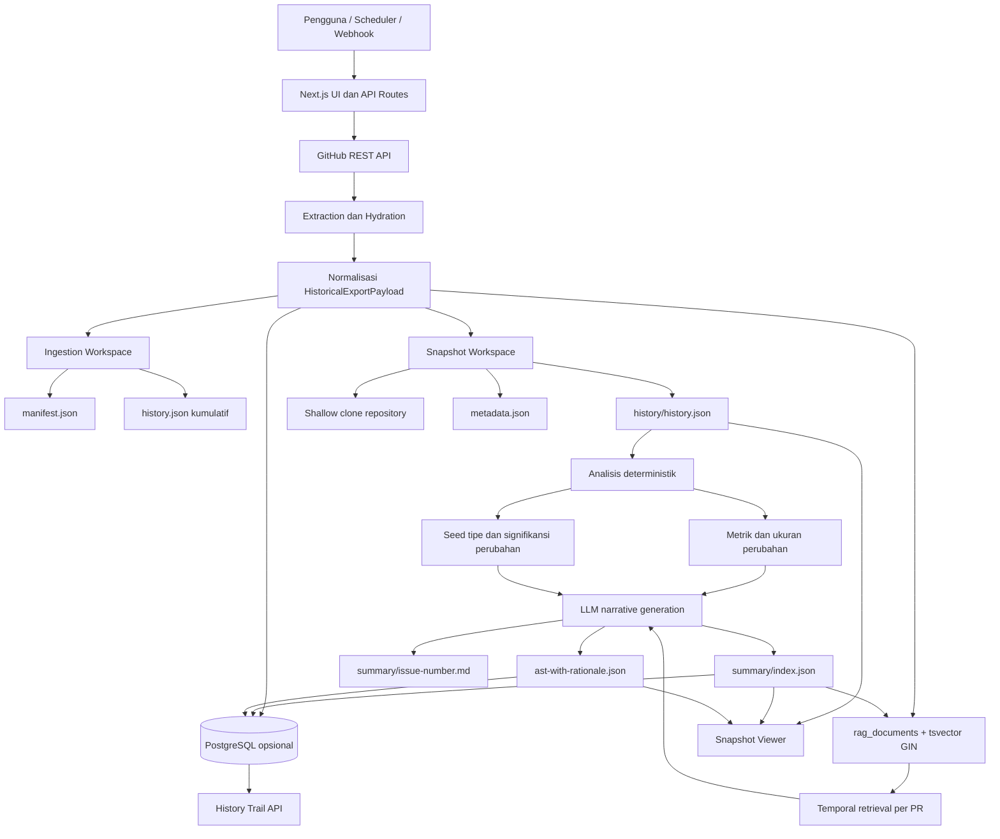

### 4.2 Konteks sistem

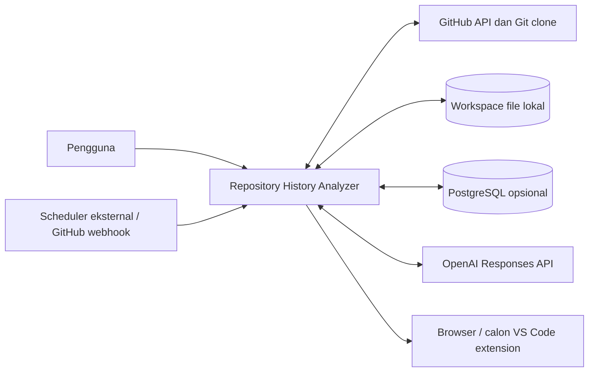

Batas sistem berada pada aplikasi Next.js. GitHub merupakan sumber data
eksternal, OpenAI menyediakan generasi naratif, sedangkan filesystem dan
PostgreSQL adalah penyimpanan yang dikelola aplikasi. VS Code extension belum
menjadi bagian implementasi; saat ini aplikasi baru menyediakan API yang dapat
dikonsumsi extension tersebut.

### 4.3 Jalur operasi yang tersedia

| Jalur | Pemicu | Proses utama | Keluaran |
| --- | --- | --- | --- |
| Eksplorasi interaktif | Pengguna pada halaman utama | UI memanggil proxy GitHub, memuat detail PR secara lazy, atau memilih merged PR di sekitar satu PR acuan berdasarkan `merged_at`, lalu membentuk payload di browser | Tampilan issue/commit/diff, export JSON, atau snapshot manual |
| Ingestion otomatis | `POST /api/ingestion/trigger` atau webhook merged PR | Service memilih PR, melakukan hydration, merge histori kumulatif, membuat snapshot, lalu menjalankan summary/persistence bila dikonfigurasi | Manifest, `history.json`, snapshot, summary, PostgreSQL, dan indeks RAG |
| Analisis snapshot | Pengguna membuka `/history-snapshots/:id` | Server membaca histori, summary, dan history tree dari snapshot; clone tetap tersimpan tetapi tidak ditampilkan | Timeline, kartu diskusi, diff, rationale, dan raw JSON |
| Generasi rationale temporal | Pembuatan summary snapshot | PostgreSQL memilih evidence historis terkait dari PR lain; service memberi label arah waktu dan menambahkannya ke prompt | Rationale evolusi, retrospective outcome, dan retrieval trace |
| Integrasi eksternal | Client memanggil history-trail API | PostgreSQL menggabungkan file, commit, issue, summary, rationale, contrast, dan significance | Data histori terstruktur untuk calon VS Code extension |

Jalur interaktif dan ingestion otomatis sama-sama menghasilkan kontrak
`HistoricalExportPayload`, tetapi implementasinya berbeda. Jalur interaktif
menyimpan state sementara di browser dan melakukan hydration sesuai aksi
pengguna. Jalur otomatis seluruhnya berjalan di server dan menyimpan progres
antar-run melalui manifest.

### 4.4 Keputusan desain utama

| Keputusan | Implementasi | Alasan dan konsekuensi |
| --- | --- | --- |
| Backend-for-frontend | Next.js UI dan API route berada dalam satu project | Kontrak UI–server sederhana, tetapi endpoint yang terbuka harus diberi autentikasi sebelum production |
| Incremental ingestion | Mode `backfill`, `forward`, dan `issue` dengan manifest | Menghindari pemrosesan ulang seluruh repository; cursor forward saat ini belum optimal |
| Dual persistence | Snapshot file selalu tersedia; PostgreSQL aktif bila `DATABASE_URL` ada | Aplikasi tetap dapat berjalan tanpa database, tetapi data dapat terduplikasi pada dua media |
| Evidence-first traceability | Issue number, commit SHA, filename, dan `evidenceRefs` dipertahankan lintas proses | Narasi dan visualisasi dapat ditelusuri kembali ke sumber |
| Hybrid deterministic–generative | Aturan lokal menetapkan metrik/label; LLM menulis narasi | Mengurangi ketergantungan klasifikasi pada output probabilistik |
| Structured LLM output | Responses API memakai JSON Schema; Markdown dirender lokal | Bentuk hasil lebih konsisten dan mudah dipersistenkan |
| Snapshot-oriented analysis | Histori, clone, summary, dan tree dikelompokkan berdasarkan snapshot ID | Mendukung reproduksi tampilan, tetapi clone `depth 1` bukan histori Git lengkap |
| Lexical RAG | PostgreSQL FTS + GIN + substring fallback | Sederhana dan audit-friendly, tetapi belum menangkap kesamaan semantik lintas istilah/bahasa |

### 4.5 Pembagian layer

| Layer | Tanggung jawab | Modul utama |
| --- | --- | --- |
| Presentation | Input repository, issue journey, snapshot detail, timeline, kartu diskusi, diff, dan raw JSON; komponen tree/repo viewer masih tersedia tetapi tidak dirender | `app/page.tsx`, `app/history-viewer/components/*` |
| Client data access | Membentuk URL proxy dan memanggil API internal | `GitHubHistoryApi.ts` |
| API | Proxy GitHub, snapshot, summary, ingestion, webhook, database, extension | `app/api/**/route.ts` |
| Ingestion | Seleksi PR, hydration, merge payload, snapshot, summary, persistence | `GitHubIngestionService.ts` |
| Deterministic analysis | Metrik patch, ukuran perubahan, tipe dan signifikansi perubahan | `issueAnalysis.ts`, `changeSignificanceRules.ts` |
| Generative analysis | Narasi background, rationale, impact, dan verification | `SnapshotSummaryService.ts` |
| RAG indexing | Chunk issue, discussion, commit, patch, dan summary | `RagDocumentBuilder.ts` |
| RAG temporal retrieval | Full-text retrieval, context packing, arah waktu, dan retrieval trace | `PostgresHistoryStore.ts`, `SnapshotSummaryService.ts` |
| File persistence | Workspace ingestion dan artefak snapshot | `IngestionWorkspaceStore.ts`, `SnapshotWorkspaceStore.ts` |
| Relational persistence | Penyimpanan normalized history dan summary | `PostgresHistoryStore.ts` |

## 5. Alur Proses Aktual

### 5.1 Alur ingestion server

1. Input repository dinormalisasi menjadi format `owner/repo`.
2. Sistem memilih mode `backfill`, `forward`, atau `issue`.
3. Batch dibatasi pada 1–20 item; default-nya 3.
4. Untuk mode batch, sistem mencari merged pull request dengan GitHub Search
   API dan menghindari nomor issue yang sudah ada di manifest.
5. Setiap PR di-hydrate dengan issue comments, review comments, daftar commit,
   detail PR, dan diff per commit.
6. PR yang belum merged, tidak memiliki penanda pull request, atau tidak
   memiliki commit tidak dimasukkan ke payload historis.
7. Hasil baru digabungkan dengan `history.json` kumulatif berdasarkan
   `issueNumber`, kemudian diurutkan menggunakan `createdAt` terbaru.
8. Sistem membuat snapshot baru yang berisi histori dan shallow clone branch
   repository.
9. Jika `OPENAI_API_KEY` tersedia dan summary tidak dimatikan, sistem membuat
   atau memakai ulang summary per issue.
10. Manifest ingestion dan workspace lokal diperbarui.
11. Jika `DATABASE_URL` tersedia, payload, snapshot, run, summary, dan tree
    disimpan ke PostgreSQL dalam satu transaksi.

### 5.2 Mode ingestion

| Mode | Tujuan aktual | Catatan |
| --- | --- | --- |
| `backfill` | Melanjutkan pencarian dari `manifest.backfill.page` | Menyimpan `nextBackfillPage` dan `hasMore` |
| `forward` | Memindai dari halaman pertama dan mengambil PR yang belum pernah diproses | Field `forward.lastMergedAt` belum dipakai sebagai filter GitHub dan saat ini diisi dari `issue.createdAt`, bukan `merged_at` |
| `issue` | Memproses satu nomor PR secara langsung | Dipakai oleh webhook merged PR |

### 5.3 Sequence ingestion end-to-end

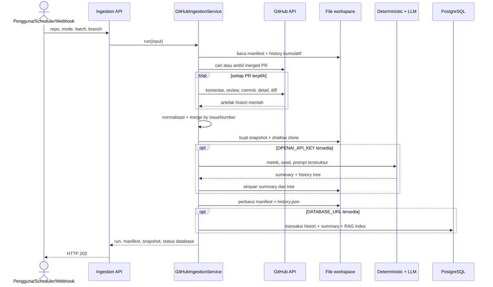

Kegagalan membuat snapshot atau mengambil data utama menggagalkan ingestion.
Sebaliknya, kegagalan summary dan persistence PostgreSQL ditangkap sebagai
pesan hasil sehingga snapshot/file workspace yang sudah berhasil dibuat tetap
dapat digunakan.

### 5.4 Alur summary

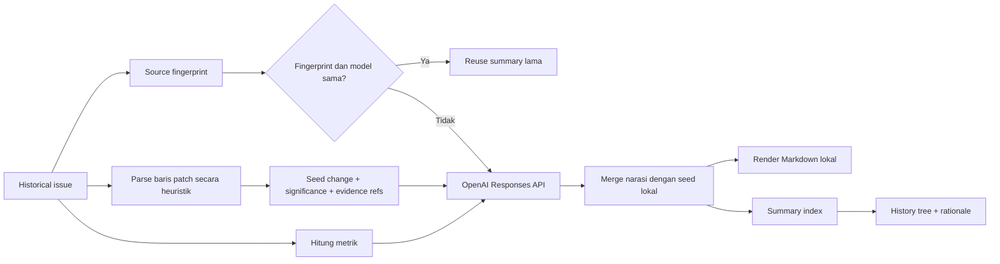

Pemisahan tanggung jawab yang perlu dijelaskan di thesis:

- Sistem lokal menentukan metrik, ukuran perubahan, label perubahan,
  significance, group, commit reference, dan patch reference.
- LLM mengisi narasi seperti background, before, after, rationale, impact,
  testing/verification, dan notes.
- Label/significance hasil aturan lokal tidak boleh diganti oleh LLM.
- Rationale diminta dalam struktur sebab–akibat–solusi:
  `Because [cause]. Therefore, [effect]. Solution: [solution].`
- Markdown dirender secara lokal dari template; LLM mengembalikan structured
  JSON, bukan dokumen Markdown akhir.

### 5.5 Flow data dan transformasi

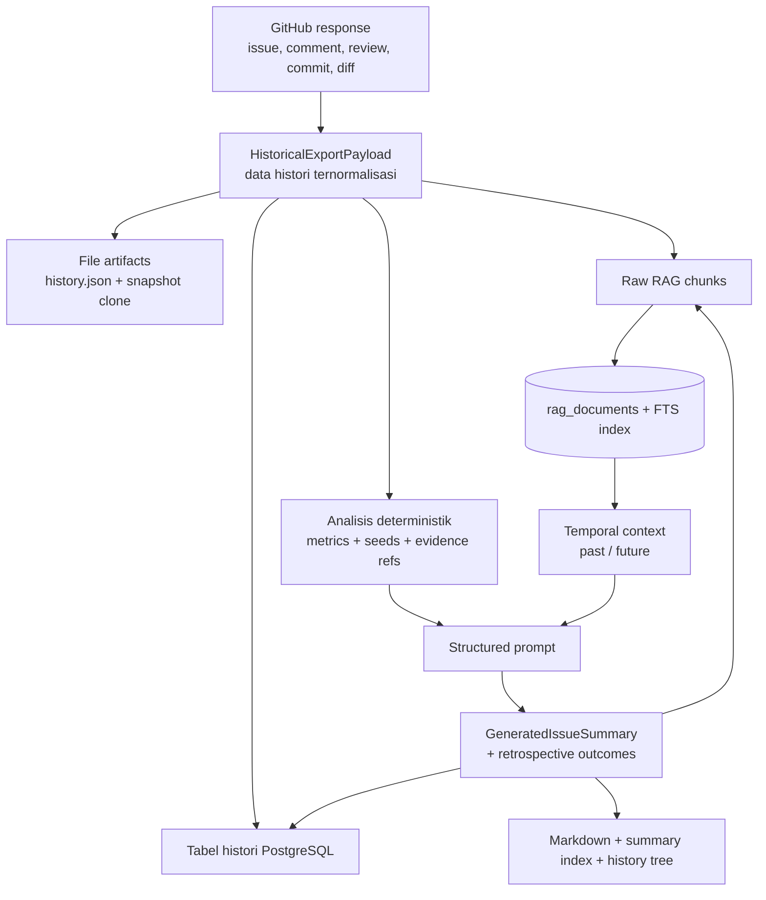

Flow tersebut menunjukkan satu proses generasi dokumentasi yang diaugmentasi
retrieval. Raw evidence di-index lebih dahulu. Sebelum summary suatu PR dibuat,
sistem mengambil konteks PR lain yang relevan, memberi label arah temporal, dan
menyertakannya pada prompt. Summary yang selesai dibuat di-index kembali agar
dapat menjadi konteks bagi perubahan kronologis berikutnya.

PostgreSQL bukan prompt itu sendiri. Database menyimpan dan mengambil evidence;
aplikasi yang mengubah evidence terpilih menjadi context prompt untuk LLM.

## 6. Data yang Diekstrak dan Dinormalisasi

### 6.1 Kontrak `HistoricalExportPayload`

```text
HistoricalExportPayload
├── repo
├── fetchedAt
├── exportType = "historical-evolution"
├── description
└── issues[]
    ├── issueNumber, title, url, createdAt, summary
    ├── discussion[]
    │   └── id, type, author, createdAt, url, body
    └── commits[]
        ├── sha, message, author, committedAt, url
        └── codeChanges[]
            └── filename, patch
```

Unit analisis utama pada implementasi sekarang adalah **merged pull request**
yang direpresentasikan sebagai `HistoricalIssueEntry`. Satu issue menghubungkan
diskusi, commit, dan patch yang akan dipakai untuk analisis selanjutnya.

### 6.2 Artefak file

```text
storage/
├── repo-ingestion/<repo-sanitized>/
│   ├── manifest.json
│   └── history.json
└── history-snapshots/<snapshot-id>/
    ├── metadata.json
    ├── repo/                         # shallow clone
    └── history/
        ├── history.json
        ├── ast-with-rationale.json
        └── summary/
            ├── index.json
            └── issue-<number>.md
```

Perbedaan penting:

- `repo-ingestion` menyimpan progres kumulatif dan manifest antar-run.
- `history-snapshots` menyimpan keadaan analisis pada satu waktu.
- Clone menggunakan `git clone --depth 1 --single-branch`; oleh karena itu
  clone adalah kondisi branch ketika snapshot dibuat, bukan checkout setiap
  commit historis yang dianalisis.

### 6.3 Artefak summary

Setiap summary issue menyimpan:

- background dan hubungan issue/PR;
- `whatChanged[]` beserta rationale dan evidence;
- `significanceFlags[]` hasil aturan deterministik;
- `changeContrast[]` berisi kondisi before/after;
- `changeSize` dan metrik;
- impact untuk user, system, dan developer;
- testing/verification dan notes;
- metadata model, waktu generasi, fingerprint sumber, dan reuse.

### 6.4 `ast-with-rationale.json`

Nama file ini dipertahankan untuk kompatibilitas implementasi, tetapi isi
aktualnya adalah **hierarchical history tree**, dengan struktur umum:

```text
repository
└── issues
    └── issue
        ├── discussion
        ├── commits
        │   └── commit
        │       ├── code change
        │       └── rationale
        └── summary
```

Dokumen thesis tidak boleh menyebut artefak ini sebagai AST formal dari source
code. Parser formal seperti Tree-sitter dan `code-graph.json` masih merupakan
rencana pengembangan.

### 6.5 Bentuk manifest ingestion dan metadata snapshot

```text
RepoIngestionManifest
├── repo, createdAt, updatedAt, batchSize
├── processedIssueNumbers[]
├── totalIssues, latestSnapshotId?
├── backfill
│   └── page, hasMore
├── forward
│   └── lastMergedAt
└── runs[]
    └── id, mode, status, startedAt, completedAt?,
        issueNumbers[], snapshotId?, generatedSummary, message?, error?

SnapshotRecord
├── id
├── repoName
├── requestedBranchRef
├── storedBranchRef
├── createdAt
├── snapshotDir
├── historyFile
└── repoDir
```

Manifest menggambarkan progres ingestion lintas eksekusi, sedangkan
`SnapshotRecord` menunjuk satu paket artefak yang immutable secara konseptual.
Pada implementasi saat ini, summary sebuah snapshot masih dapat dibuat ulang
dan menimpa artefak summary pada direktori snapshot yang sama.

### 6.6 Bentuk data summary

```text
GeneratedIssueSummary
├── issueNumber, title, relatedIssue, pullRequest, background
├── discussionNarratives[]
│   └── narrative, outcome, participants[], evidenceRefs[], relatedCommitIds[]
├── whatChanged[]
│   └── change, rationale, relatedCommitIds[], evidenceRefs[], evidenceSource
├── significanceFlags[]
│   └── change, significance, group, reason,
│       relatedCommitIds[], evidenceRefs[], evidenceSource
├── changeContrast[]
│   └── change, significance, group?, aspect?, before, after, rationale,
│       relatedCommitIds[], evidenceRefs[], evidenceSource
├── changeSize
│   └── level, rationale
├── metrics
│   └── discussionCount, commitCount, fileChangedCount, codeChangeCount,
│       additions, deletions, hunkCount
├── impact
│   └── user[], system[], developer[]
├── testingVerification[], retrospectiveOutcomes[], dan notes[]
├── markdown dan markdownFile
└── generatedAt, model, sourceLastCommitAt?, sourceFingerprint?,
    reusedFromGeneratedAt?, retrievalContext?
```

`evidenceSource` dibatasi pada `discussion`, `commit_message`,
`patch_excerpt`, atau `inferred`. Field ini membedakan bukti eksplisit dari
kesimpulan yang dihasilkan melalui inferensi. Walaupun dinamai
`sourceFingerprint`, nilai aktualnya adalah hasil `JSON.stringify` dari sumber
issue, diskusi, commit, patch, dan context temporal yang terambil—bukan
digest/hash kriptografis.

### 6.7 Bentuk data RAG

```text
RagDocumentInput
├── id = <snapshot>:<kind>:<source>:chunk-<n>
├── kind = issue | discussion | commit | patch | summary
├── issueNumber?, commitSha?, filename?
├── title, content
├── evidenceRefs[]
└── metadata

SummaryRetrievalContext
├── query dan targetAt
├── retrievalMethod
│   └── postgres-full-text | postgres-substring-fallback | unavailable
└── documents[]
    ├── documentId, kind, issueNumber?, commitSha?, filename?
    ├── sourceAt dan temporalDirection
    │   └── past | current | future | unknown
    ├── evidenceRefs[] dan score
    └── title
```

ID dokumen mengandung snapshot sehingga chunk antar-snapshot tidak bertabrakan.
Retrieval trace disimpan bersama summary agar konteks yang memengaruhi generasi
dapat diaudit. `retrospectiveOutcomes` hanya dipertahankan bila evidence reference
berasal dari dokumen berlabel `future`.

### 6.8 Identitas dan traceability lintas bentuk data

| Identifier | Asal | Dipertahankan pada | Fungsi traceability |
| --- | --- | --- | --- |
| `snapshotId` | Aplikasi saat snapshot dibuat | metadata, summary, tree, database, RAG document | Membatasi versi data yang dianalisis |
| `issueNumber` | GitHub PR/issue | payload, summary, database, RAG | Menghubungkan intent/diskusi dengan perubahan |
| `commitSha` | Git commit | payload, database, tree, timeline, RAG | Menghubungkan narasi dengan unit perubahan kode |
| `filename` | GitHub diff / clone | patch, database, repository viewer, extension API, RAG | Menavigasi histori pada file tertentu |
| `evidenceRefs` | Dibentuk aplikasi | summary, significance, RAG | Menunjuk `issue:`, `commit:`, `patch:`, atau discussion reference |
| `sourceFingerprint` | Serialisasi JSON dari input summary | summary index dan PostgreSQL | Menentukan apakah summary lama dapat dipakai ulang melalui perbandingan equality |

## 7. Metode Analisis Deterministik

### 7.1 Metrik issue

Metrik dihitung langsung dari payload dan patch:

| Metrik | Cara hitung |
| --- | --- |
| `discussionCount` | Jumlah issue comment dan review comment |
| `commitCount` | Jumlah commit dalam PR |
| `fileChangedCount` | Jumlah path file unik di seluruh commit |
| `codeChangeCount` | Jumlah pasangan commit–file |
| `additions` | Baris patch dengan awalan `+`, selain header `+++` |
| `deletions` | Baris patch dengan awalan `-`, selain header `---` |
| `hunkCount` | Baris patch dengan awalan `@@` |

### 7.2 Klasifikasi ukuran perubahan

Skor cakupan:

```text
weightedScope =
  (fileChangedCount × 3) +
  (commitCount × 2) +
  hunkCount +
  ceil((additions + deletions) / 40)
```

Aturan kelas:

- **large** apabila skor ≥ 24, atau file ≥ 8, atau commit ≥ 5, atau hunk ≥ 12;
- **medium** apabila skor ≥ 10, atau file ≥ 3, atau commit ≥ 2, atau hunk ≥ 4;
- **small** untuk kondisi selain itu.

Klasifikasi ini adalah aturan engineering yang eksplisit, bukan hasil training
model statistik.

### 7.3 Inferensi tipe perubahan

Patch dikelompokkan per hunk, lalu baris tambah/hapus dianalisis menggunakan
pola sintaks dan indentasi. Sistem dapat memberi label pada kategori berikut:

- kondisi loop dan control structure;
- insert/delete else-part;
- insert/delete, update, ordering, atau perpindahan parent statement;
- perubahan comment;
- insert/delete atau update class, interface, type, dan enum;
- perubahan jumlah, urutan, nama, atau type parameter; dan
- insert/delete atau update return type.

Setiap jenis perubahan dipetakan ke tingkat `None`, `Low`, `Medium`, atau
`Crucial` beserta group dan alasan yang tetap. Contohnya, perubahan comment
dianggap `None`, perubahan control condition dianggap `Medium`, sedangkan
perubahan kontrak class/interface/parameter/return type dianggap `Crucial`.

Metode ini bersifat **AST-friendly**, tetapi masih heuristic berbasis teks
patch. Kemungkinan false positive/false negative harus diakui pada bagian
keterbatasan penelitian.

## 8. Peran, Alur, dan Batas Penggunaan LLM

> **Posisi utama LLM:** model tidak mengambil data GitHub, tidak menentukan
> metrik, dan tidak menetapkan label significance. LLM menerima evidence yang
> sudah dipilih dan dibatasi oleh aplikasi, lalu mengubahnya menjadi narasi
> evolusi kode yang terstruktur. Karena itu, implementasi ini bersifat
> **hybrid deterministic–generative**, bukan generasi bebas dari raw repository.

### 8.1 Posisi LLM dalam pipeline

LLM dipanggil pada tahap pembuatan summary, setelah histori GitHub sudah
dinormalisasi menjadi `HistoricalExportPayload`. Pemanggilan dapat terjadi:

1. secara manual melalui `POST /api/history-snapshots/:id/summary`; atau
2. secara otomatis dari ingestion service ketika summary generation diaktifkan.

Endpoint menerima `apiKey?`, `model?`, dan `forceRegenerate?`. API key dari body
request dipakai lebih dahulu, lalu fallback ke `OPENAI_API_KEY`. Model default
adalah `gpt-5-mini`. Untuk setiap PR yang benar-benar perlu dibuat ulang,
service mengirim satu request ke OpenAI Responses API dengan `reasoning.effort`
`low`, `text.verbosity` `low`, dan strict JSON Schema.

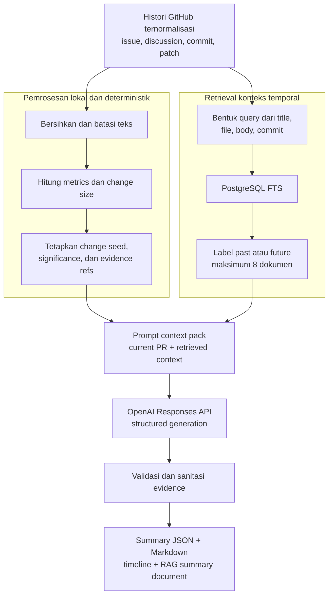

Diagram tersebut menegaskan bahwa model berada setelah extraction, retrieval,
dan deterministic analysis. Dengan demikian, kualitas narasi memang bergantung
pada model, tetapi ruang fakta dan identitas evidence tetap dibatasi oleh
aplikasi.

### 8.2 Alur rinci per pull request

PR diproses satu per satu dalam urutan kronologis. Anchor waktunya memakai waktu
commit terakhir; jika commit tidak memiliki waktu valid, sistem memakai
`createdAt` PR. Urutan ini penting karena summary yang selesai dapat langsung
di-index kembali dan menjadi konteks historis untuk PR berikutnya.

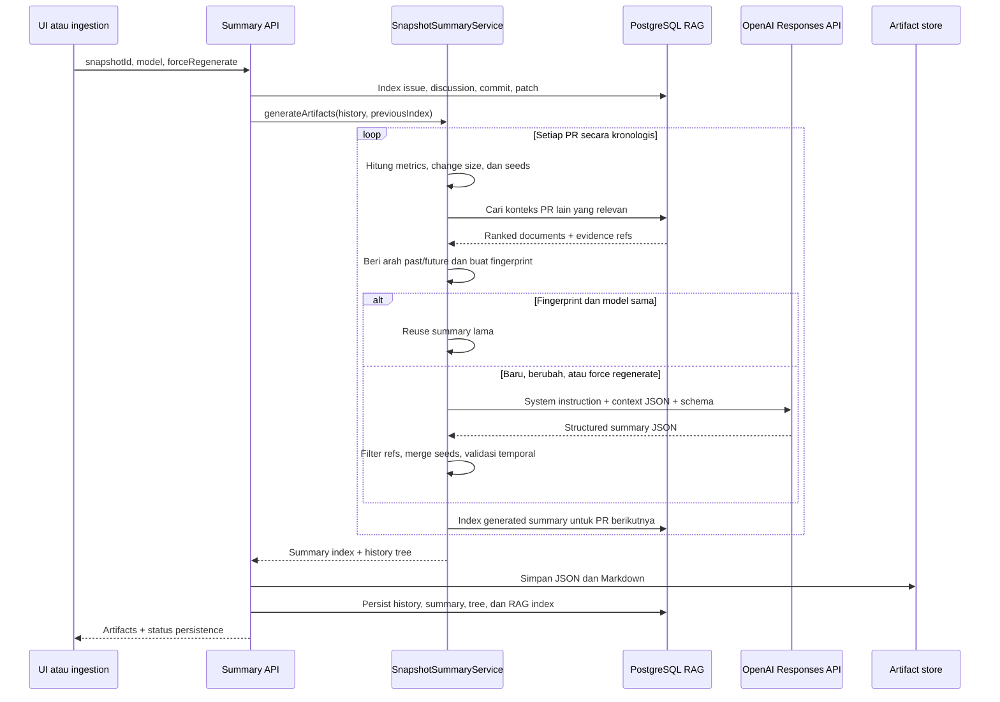

Rincian prosesnya adalah:

1. **Pre-index raw evidence.** Route summary membangun ulang dokumen RAG dari
   issue, discussion, commit, dan patch sebelum generasi dimulai.
2. **Sort kronologis.** Semua PR diurutkan berdasarkan temporal anchor agar
   evolusi dapat diproses dari perubahan lebih awal ke perubahan lebih baru.
3. **Analisis lokal.** Sistem menghitung metrik patch, change size, serta seed
   change contrast beserta significance dan evidence reference.
4. **Temporal retrieval.** Sistem mencari evidence dari PR lain, mengecualikan
   PR aktif, lalu memberi label `past`, `future`, `current`, atau `unknown`.
5. **Fingerprint check.** Input PR dan retrieved context diserialisasi menjadi
   `sourceFingerprint`. Jika fingerprint dan model sama, summary lama dipakai
   kembali kecuali `forceRegenerate=true`.
6. **Prompt construction.** Current PR, hasil deterministic analysis, dan
   temporal context disusun menjadi satu JSON context pack.
7. **Structured generation.** LLM mengembalikan object sesuai JSON Schema;
   bukan Markdown bebas.
8. **Post-validation.** Server membuang atau memperbaiki reference yang tidak
   sah, lalu menggabungkan narasi model dengan seed lokal.
9. **Render dan persistence.** Markdown dirender dari template lokal, artefak
   disimpan, dan summary di-index kembali sebagai knowledge untuk PR lain.

### 8.3 Data yang diterima LLM

LLM tidak menerima seluruh clone repository. Payload dibangun hanya dari
evidence yang telah masuk ke `history.json` dan dokumen temporal terpilih.

| Komponen input | Sumber | Transformasi sebelum dikirim | Fungsi dalam generasi |
| --- | --- | --- | --- |
| Identitas PR | issue number, title, URL | Dipertahankan sebagai anchor current PR | Menentukan objek perubahan yang sedang dijelaskan |
| PR body/summary | `issue.summary` | Markdown/HTML dibersihkan, maksimum 2.000 karakter | Bukti awal mengenai tujuan dan latar belakang |
| Human discussion | issue comment dan review comment | Bot disaring; markup dibersihkan; maksimum 2.000 karakter per komentar dengan bagian awal dan akhir dipertahankan | Bukti utama intent, concern, alternatif, keputusan, dan outcome |
| Metrics | Perhitungan lokal atas payload dan patch | Tidak dibuat oleh LLM | Memberi ukuran perubahan yang konsisten |
| Change contrast seeds | Heuristic `issueAnalysis.ts` | Change, significance, group, reason, commit ID, evidence refs, dan evidence source sudah dikunci | Menentukan aspek perubahan yang wajib dijelaskan model |
| Commit context | Commit GitHub | SHA, short SHA, pesan, author, waktu, dan daftar file | Memverifikasi unit implementasi dan kronologi |
| Patch excerpt | Diff setiap file | Maksimum 120 baris dan 6.000 karakter per file; total 60.000 karakter | Memverifikasi perubahan kode aktual |
| Temporal RAG context | `rag_documents` dari PR lain | Maksimum 8 dokumen, 2.500 karakter per dokumen, total 18.000 karakter | Menjelaskan keputusan sebelumnya atau outcome setelahnya |

Patch tidak dipilih hanya berdasarkan urutan file. Kandidat patch diprioritaskan
menurut significance: `Crucial`, `Medium`, `Low`, lalu `None`. Pendekatan ini
memberi ruang context lebih dahulu kepada perubahan yang secara lokal dianggap
paling penting.

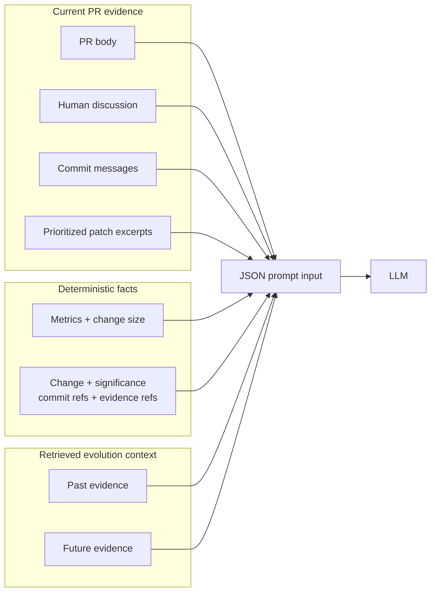

### 8.4 Instruksi dan proses generasi di LLM

Request ke Responses API memiliki dua message utama:

- **System instruction** menetapkan peran, aturan evidence, batas temporal,
  format rationale, dan larangan inventing facts.
- **User input** berisi hasil `JSON.stringify(buildPromptInput(...))`, yaitu
  context pack spesifik untuk satu PR.

Aturan penting pada system instruction adalah:

- seluruh field naratif ditulis dalam bahasa Inggris;
- PR body dan human discussion menjadi bukti utama intent dan keputusan;
- commit message dan patch dipakai untuk memverifikasi implementasi;
- komentar bot dan deployment chatter diabaikan;
- commit ID serta evidence reference harus berasal dari context yang diberikan;
- rationale mengikuti pola
  `Because [cause]. Therefore, [effect]. Solution: [implemented solution].`;
- bukti `past` dapat menjelaskan constraint atau keputusan sebelumnya;
- bukti `future` dilarang dipakai sebagai motivasi asli perubahan; dan
- bukti `future` hanya boleh menghasilkan `retrospectiveOutcomes`.

Model diminta mengisi JSON Schema berikut secara konseptual:

```text
LLM structured output
├── relatedIssue
├── background
├── discussionNarratives[]
│   └── narrative, outcome, evidenceRefs[], relatedCommitIds[]
├── whatChanged[]
│   └── change, rationale, relatedCommitIds[], evidenceRefs[], evidenceSource
├── changeContrast[]
│   └── before, after, rationale
├── impact
│   └── user[], system[], developer[]
├── testingVerification[]
├── retrospectiveOutcomes[]
│   └── outcome, evidenceRefs[]
└── notes[]
```

`additionalProperties: false` dan daftar field `required` membuat bentuk output
lebih stabil. Namun structured output hanya menjamin bentuk data, bukan otomatis
menjamin kebenaran makna. Karena itu validasi evidence tetap dilakukan setelah
response diterima. Request saat ini juga tidak menetapkan `temperature` atau
`seed`; hasil generasi tidak boleh dianggap deterministik sepenuhnya. Model,
waktu generasi, source fingerprint, prompt/schema, dan output yang tersimpan
perlu dipertahankan untuk reproducibility eksperimen.

### 8.5 Validasi dan penggabungan setelah generasi

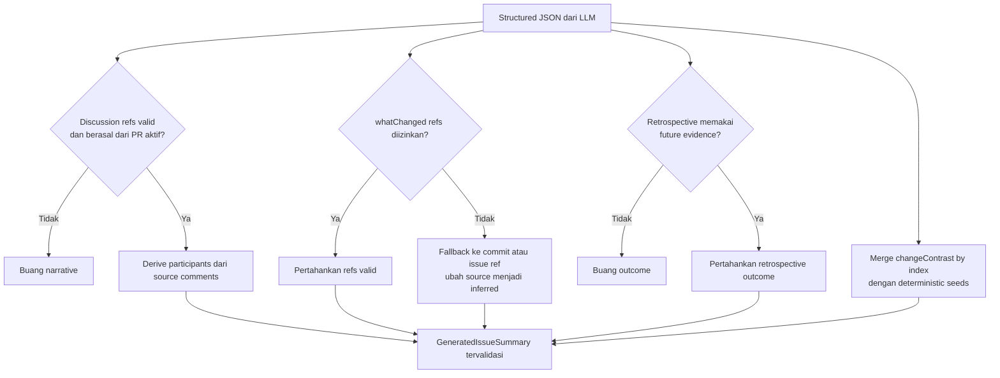

Validasi server meliputi:

1. `discussionNarratives` hanya dipertahankan jika memiliki narrative dan
   reference ke human comment yang benar-benar ada pada PR aktif. Participant
   tidak dipercaya dari model, tetapi diturunkan ulang dari author comment.
2. `relatedCommitIds` pada discussion diselesaikan kembali terhadap SHA commit
   aktual pada PR.
3. `whatChanged.evidenceRefs` difilter terhadap issue, discussion, commit, dan
   patch PR aktif, ditambah retrieved context yang bukan future evidence.
4. Jika `whatChanged` kehilangan semua evidence reference, server menggunakan
   related commit yang valid atau `issue:<number>`, lalu menandainya sebagai
   `inferred`.
5. `retrospectiveOutcomes` hanya dipertahankan bila mereferensikan evidence dari
   dokumen berarah `future`.
6. `changeContrast` digabungkan berdasarkan urutan seed. Change label,
   significance, group, commit ID, evidence refs, dan evidence source tetap
   berasal dari deterministic analysis; LLM hanya menyumbang `before`, `after`,
   dan `rationale`.

### 8.6 Hasil dan pemakaian output LLM

Setelah validasi, service membentuk `GeneratedIssueSummary`, merender Markdown
dengan template lokal, lalu menghasilkan beberapa artefak:

| Hasil | Lokasi/bentuk | Pemakaian |
| --- | --- | --- |
| Summary index | `history/summary/index.json` | Sumber data utama Evolution Timeline, kartu discussion, rationale, dan quantitative testing |
| Summary per PR | `history/summary/issue-<number>.md` | Dokumentasi manusia yang dapat dibaca dan disalin ke laporan |
| History tree | `history/ast-with-rationale.json` | Relasi issue–discussion–commit–change–rationale; bukan AST bahasa formal |
| PostgreSQL summary rows | Tabel summary dan evidence terkait | Query lintas snapshot dan history-trail API |
| RAG summary chunks | `rag_documents` berjenis `summary` | Knowledge tambahan untuk generasi PR berikutnya |
| Retrieval trace | `retrievalContext` dalam summary | Audit query, score, arah waktu, dan evidence yang masuk ke prompt |

Markdown akhir tidak ditulis langsung oleh LLM. Aplikasi memasukkan structured
summary ke `docs/pr-sum-standard/template.txt`, sehingga susunan dokumen tetap
konsisten walaupun model berubah.

### 8.7 Pembagian tanggung jawab lokal dan LLM

| Keputusan/proses | Sistem lokal | LLM |
| --- | :---: | :---: |
| Mengambil data GitHub dan membentuk snapshot | Ya | Tidak |
| Memfilter bot dan memotong context | Ya | Tidak |
| Menghitung additions, deletions, hunk, dan change size | Ya | Tidak |
| Menetapkan change label, significance, group, dan evidence seed | Ya | Tidak |
| Mencari context temporal melalui PostgreSQL | Ya | Tidak |
| Menulis background dan narasi discussion | Tidak | Ya |
| Menjelaskan cause–effect–solution | Tidak | Ya |
| Menulis before/after untuk seed yang telah ditetapkan | Tidak | Ya |
| Menentukan impact, testing/verification, dan notes | Tidak | Ya |
| Memvalidasi evidence refs dan temporal direction | Ya | Tidak |
| Merender dan menyimpan Markdown | Ya | Tidak |

Pemisahan ini merupakan kontrol utama terhadap hallucination: model boleh
menyusun bahasa dan hubungan naratif, tetapi identitas perubahan penting dan
jejak evidence akhirnya tetap dikendalikan aplikasi.

### 8.8 RAG berbasis PostgreSQL

Implementasi RAG MVP menggunakan artefak histori yang sudah tersedia sebagai
knowledge base. Index dibuat otomatis pada persistence ingestion dan dapat
dibangun ulang untuk snapshot lama melalui `POST /api/rag/index`.

RAG tidak diekspos sebagai fitur tanya jawab. Retriever dipanggil secara internal
oleh `SnapshotSummaryService` sebelum rationale dan dokumentasi evolusi dibuat.
PostgreSQL tidak mengirim seluruh histori ke LLM; hanya evidence relevan dari
perubahan lain yang dimasukkan sebagai context tambahan.

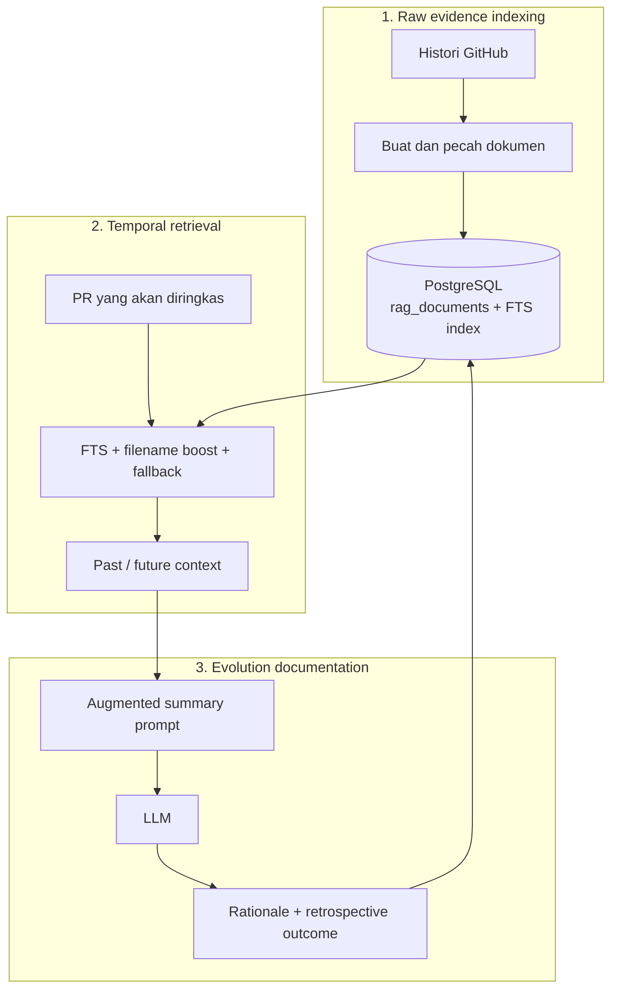

Dengan demikian, komponen RAG-nya adalah: `rag_documents` sebagai knowledge
base, PostgreSQL full-text search sebagai retriever, context pack sebagai hasil
augmentasi prompt, dan OpenAI Responses API sebagai generator. Implementasi ini
adalah **lexical/full-text RAG**, bukan vector RAG berbasis embedding.

Tahapannya adalah:

1. issue, discussion, commit, patch, dan generated summary diubah menjadi
   dokumen retrieval;
2. teks dipecah menjadi chunk maksimum 4.000 karakter dengan overlap 400
   karakter;
3. setiap chunk disimpan pada `rag_documents` bersama issue number, commit SHA,
   filename, metadata, dan `evidenceRefs`;
4. PostgreSQL membentuk generated `tsvector` dengan konfigurasi `simple`;
5. title diberi weight `A`, sedangkan content diberi weight `B`;
6. GIN index mempercepat pencarian dan `ts_rank_cd` memberi relevance score;
7. query retrieval dibentuk otomatis dari filename, judul PR, deskripsi, dan
   commit message PR yang sedang dianalisis;
8. PR yang sedang diringkas dikeluarkan dari hasil agar context tidak hanya
   menduplikasi input utama;
9. exact filename diberi tambahan skor, sedangkan substring search dipakai jika
   full-text query tidak menemukan hasil;
10. kandidat diberi `sourceAt` dan arah `past`, `current`, `future`, atau
    `unknown`, lalu dipilih maksimum delapan dokumen dengan upaya menjaga
    representasi past dan future;
11. context temporal dibatasi 18.000 karakter dan 2.500 karakter per dokumen;
12. evidence masa depan hanya boleh membentuk `retrospectiveOutcomes`, bukan
    original rationale; evidence reference pada rationale utama difilter agar
    hanya berasal dari PR aktif atau context non-future;
13. retrospective outcome tanpa future evidence reference yang valid dibuang;
    dan
14. summary yang selesai dibuat di-index kembali agar dapat menjadi knowledge
    untuk PR berikutnya dalam urutan kronologis.

### 8.9 Smoke test implementasi RAG

Baseline retrieval pada 27 Oktober 2026 memakai snapshot
`excalidraw/excalidraw` yang sudah tersedia:

- 679 document chunks berhasil di-index;
- batch re-index selesai sekitar 3 detik setelah optimasi batch insert;
- query `tooltip collaborator leaving` memakai PostgreSQL full-text retrieval
  dan tiga hasil teratas seluruhnya berasal dari PR #12188.

Hasil lama yang menguji jawaban dan citation tidak lagi menjadi kontrak produk
karena fitur Q&A telah dihapus. Pengujian setelah redesain difokuskan pada
relevansi context temporal, ketepatan arah waktu, pemisahan original rationale
dan retrospective outcome, serta keterlacakan `retrievalContext`.

Pada 7 November 2026, smoke test redesain dijalankan untuk PR #12188 dengan
snapshot lengkap yang sama:

- 596 raw document chunks berhasil di-index;
- retrieval menggunakan `postgres-full-text` dan memilih delapan context;
- context terpilih terdiri atas tujuh dokumen `future` dan satu dokumen `past`;
- structured summary menghasilkan delapan `whatChanged` dengan evidence refs
  yang tetap berasal dari commit/patch PR aktif;
- satu retrospective outcome dipertahankan karena memiliki future patch
  evidence yang valid; dan
- Markdown hasil generasi memuat bagian `Retrospective Outcomes`.

### 8.10 Kondisi fallback dan kegagalan

| Kondisi | Perilaku implementasi | Dampak terhadap hasil |
| --- | --- | --- |
| API key tidak tersedia | Endpoint manual mengembalikan HTTP 400; ingestion otomatis melewati summary generation | Snapshot dan raw history tetap dapat digunakan tanpa narasi LLM |
| `DATABASE_URL` tidak tersedia | Retrieval diberi status `unavailable` dan context temporal kosong | LLM masih dapat merangkum current PR, tetapi tanpa augmentasi RAG lintas PR |
| Query FTS tidak menemukan hasil | PostgreSQL mencoba substring fallback | Retrieval tetap lexical dan kemungkinan memiliki precision lebih rendah |
| Retrieval atau indexing summary gagal | Error optional RAG ditangani agar generasi current PR tetap dapat berjalan | Summary dapat tersedia walaupun retrieval trace kosong atau indexing tertunda |
| OpenAI mengembalikan error atau output kosong | Summary generation gagal dan endpoint mengembalikan HTTP 500 | Raw snapshot tetap ada; artefak summary baru tidak dianggap selesai |
| Source fingerprint dan model tidak berubah | Summary lama digunakan kembali | Mengurangi request LLM dan menjaga hasil lama, kecuali force regenerate dipilih |

Fallback tersebut menjaga ingestion dan snapshot tidak bergantung mutlak pada
LLM atau PostgreSQL. Namun hasil tanpa temporal context harus diberi penanda
berbeda pada evaluasi karena kondisi input modelnya tidak setara dengan run RAG
yang berhasil.

## 9. Skema PostgreSQL

PostgreSQL bersifat opsional. Bila `DATABASE_URL` tidak tersedia, ingestion dan
snapshot file tetap dapat berjalan. Bila tersedia, schema dibuat idempotent dan
penyimpanan satu hasil ingestion dilakukan di dalam transaksi.

### 9.1 ERD histori inti

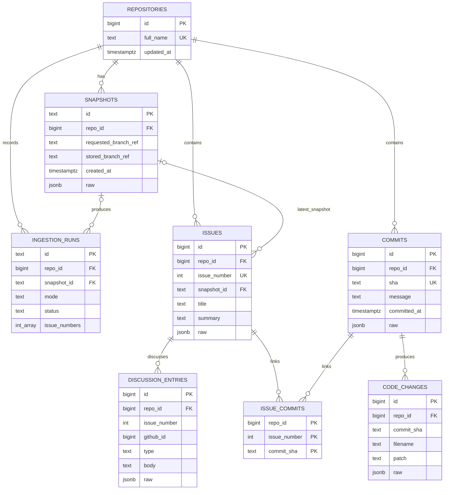

### 9.2 ERD hasil analisis dan RAG

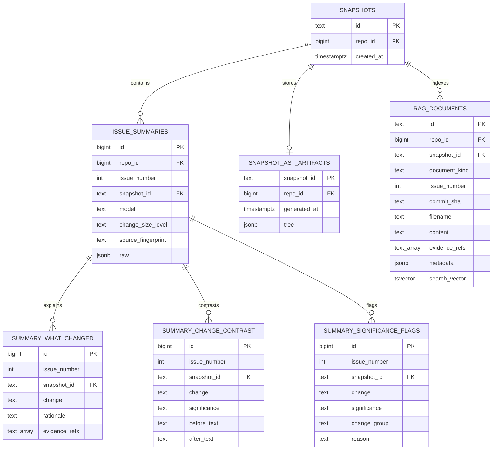

Diagram tersebut adalah ERD konseptual yang mengikuti cara data dihubungkan
oleh aplikasi. Sebagian relasi anak summary serta relasi issue–discussion–commit
ditautkan melalui business key (`repo_id`, `issue_number`, `commit_sha`, dan
`snapshot_id`), tetapi belum semuanya dideklarasikan sebagai foreign key fisik
di PostgreSQL.

### 9.3 Data dictionary dan pola penulisan

| Kelompok | Tabel | Kunci/isi utama | Pola penulisan |
| --- | --- | --- | --- |
| Repository | `repositories` | `id`, unique `full_name` | Upsert berdasarkan nama repository |
| Snapshot | `snapshots` | snapshot ID, branch, path artefak, `raw` | Upsert berdasarkan snapshot ID |
| Operasional | `ingestion_runs` | mode, status, issue numbers, snapshot, error | Upsert berdasarkan run ID |
| Histori | `issues` | unique repo + issue number, title, body, `raw` | Upsert; `snapshot_id` menunjuk snapshot terbaru yang memuat issue |
| Histori | `discussion_entries` | repo + issue + type + GitHub ID, author, body | Upsert berdasarkan identity GitHub |
| Histori | `commits` | unique repo + SHA, message, author, waktu | Upsert berdasarkan commit SHA |
| Histori | `issue_commits` | repo + issue + commit | Insert link, abaikan konflik |
| Histori | `code_changes` | repo + commit + filename, patch | Upsert berdasarkan file pada commit |
| Analisis | `issue_summaries` | snapshot + issue, markdown, model, fingerprint, `raw` | Upsert per issue per snapshot |
| Analisis | `summary_what_changed` | perubahan, rationale, commit dan evidence refs | Hapus lalu tulis ulang per snapshot |
| Analisis | `summary_change_contrast` | before/after, significance, rationale | Hapus lalu tulis ulang per snapshot |
| Analisis | `summary_significance_flags` | kind, level, group, reason, evidence | Hapus lalu tulis ulang per snapshot |
| Visualisasi | `snapshot_ast_artifacts` | satu JSON history tree per snapshot | Upsert berdasarkan snapshot ID |
| RAG | `rag_documents` | chunk, metadata, evidence, generated `tsvector` | Hapus lalu batch insert per snapshot, 100 dokumen per batch |

Sebagian besar entitas menyimpan kolom terstruktur sekaligus `raw jsonb`.
Pendekatan ini menjaga query relasional tetap memungkinkan tanpa kehilangan
payload asal untuk audit atau migrasi. Tabel RAG tidak menyimpan embedding;
`search_vector` dibentuk otomatis dari title dan content.

## 10. Endpoint Runtime

| Method | Endpoint | Fungsi | Proteksi saat ini |
| --- | --- | --- | --- |
| GET | `/api/github` | Proxy request ke GitHub REST API | Tidak ada auth aplikasi |
| GET | `/api/github/debug` | Status token dan rate limit GitHub | Tidak ada auth aplikasi |
| GET/POST | `/api/history-snapshots` | Daftar / membuat snapshot | Tidak ada auth aplikasi |
| GET/POST | `/api/history-snapshots/:id/summary` | Membaca / menghasilkan ulang summary | Tidak ada auth aplikasi |
| GET/POST | `/api/history-snapshots/:id/evaluation` | Membaca draft/hasil dan menjalankan quantitative testing dengan ground truth hasil review | Tidak ada auth aplikasi |
| GET | `/api/history-snapshots/:id/repo` | Daftar file clone | Tidak ada auth aplikasi |
| GET | `/api/history-snapshots/:id/repo/file` | Membaca file clone | Tidak ada auth aplikasi |
| POST | `/api/ingestion/trigger` | Menjalankan ingestion | Bearer atau `x-ingestion-secret` bila secret dikonfigurasi |
| GET/POST | `/api/database` | Status / inisialisasi schema | POST memakai ingestion secret bila dikonfigurasi |
| GET | `/api/database/significance-flags` | Query significance flags | Ingestion secret bila dikonfigurasi |
| GET | `/api/extension/history-trail` | Histori file/issue/commit untuk extension | Ingestion secret bila dikonfigurasi; CORS configurable |
| POST | `/api/rag/index` | Membentuk ulang knowledge index untuk satu snapshot | Ingestion secret bila dikonfigurasi |
| GET/POST | `/api/webhook` | Health check / receiver webhook | `x-ingestion-secret`; belum memakai signature GitHub |

### 10.1 Kontrak input-output utama

| Endpoint | Input utama | Output utama |
| --- | --- | --- |
| `POST /api/ingestion/trigger` | `repo`, `mode?`, `batchSize?`, `branchRef?`, `issueNumber?`, `generateSummaries?`, `model?` | `run`, manifest terbaru, snapshot, dan status persistence database |
| `POST /api/history-snapshots` | `repoName`, `branchRef`, `HistoricalExportPayload` | `SnapshotRecord` |
| `POST /api/history-snapshots/:id/summary` | `apiKey?`, `model?`, `forceRegenerate?` | summary index, history tree, retrieval trace, default model, dan status database |
| `POST /api/history-snapshots/:id/evaluation` | `groundTruth`, `generatedComparison` | silver ground truth, generated comparison, BERTScore P/R/F1, discussion utilization, dan metadata metric engine |
| `POST /api/rag/index` | `snapshotId` | repo, snapshot ID, dan jumlah dokumen yang di-index |
| `GET /api/extension/history-trail` | query `repo` serta filter opsional file, snapshot, issue, commit, dan limit | daftar aktivitas file/commit yang diperkaya rationale, contrast, dan significance |

Temporal retrieval merupakan panggilan service internal, bukan endpoint publik.
Kandidat pencarian dibatasi 24 sebelum seleksi konteks maksimum delapan dokumen.

### 10.2 Boundary keamanan API

- `INGESTION_TRIGGER_SECRET` bersifat conditional: bila variable tidak diisi,
  endpoint yang memeriksanya menerima request tanpa secret.
- Proxy `/api/github` menerima path endpoint dari query string dan belum
  memiliki allowlist resource GitHub.
- Webhook memakai shared header secret aplikasi, bukan validasi signature
  payload `X-Hub-Signature-256` standar GitHub.

## 11. Antarmuka dan Visualisasi

### Halaman utama

- input URL repository;
- status token dan rate limit GitHub;
- pagination issue/PR;
- lazy hydration detail PR;
- comparator before/after dari patch;
- export JSON;
- automation berdasarkan jumlah halaman, merged-only, dan date range;
- automation dari URL merged PR acuan dengan konfigurasi jumlah PR sebelum
  dan sesudah menurut waktu merge; dan
- daftar snapshot tersimpan.

### Halaman snapshot

- statistik jumlah PR story, discussion, commit, file, dan code change;
- generator dan viewer summary Markdown;
- timeline horizontal dari PR lama ke terbaru, dengan commit yang dikelompokkan
  per PR serta tanggal PR/commit yang ditonjolkan;
- kartu Discussion Narrative berisi narasi, outcome, participant, commit
  terkait, dan evidence pada saved summary serta detail timeline; keadaan awal
  hanya menampilkan dua baris narasi dan tombol `Inspect more`;
- code snippet patch untuk commit timeline yang dipilih, dengan file berubah
  disusun sebagai directory tree; dan
- Quantitative Testing dengan trigger pipeline, editor human review, metric
  cards, raw ground-truth JSON, generated comparison JSON, dan metrics JSON;
- Raw JSON dalam panel collapsible.

Komponen D3 collapsible tree dan repository viewer masih dipertahankan di
codebase, tetapi untuk scope UI saat ini keduanya tidak dirender pada halaman
snapshot.

## 12. Konfigurasi dan Deployment

Environment variable yang dipakai:

| Variable | Kegunaan |
| --- | --- |
| `GITHUB_TOKEN` | Autentikasi GitHub API dan clone private repository |
| `OPENAI_API_KEY` | Pembuatan summary, rationale, dan retrospective outcome yang diaugmentasi retrieval |
| `DATABASE_URL` | Koneksi PostgreSQL runtime |
| `DATABASE_URL_UNPOOLED` | Alternatif khusus script inisialisasi schema |
| `INGESTION_TRIGGER_SECRET` | Proteksi trigger, database API, dan extension API |
| `EVALUATION_PYTHON` | Opsional; executable Python virtual environment untuk evaluator BERTScore |
| `WEBHOOK_GENERATE_SUMMARIES` | Mengaktifkan summary otomatis dari webhook |
| `EXTENSION_API_ALLOWED_ORIGIN` | Konfigurasi CORS history-trail API |

Repository memiliki konfigurasi Firebase App Hosting pada `apphosting.yaml`:
minimum instance 0, maksimum 10, concurrency 80, 1 CPU, dan memory 1.024 MiB.
Keberadaan konfigurasi tidak otomatis membuktikan bahwa aplikasi telah
di-deploy; status deployment harus dicatat dari environment operasional.

## 13. Keterbatasan dan Risiko Validitas

Bagian ini penting agar laporan tidak overclaim.

1. **Batas pagination GitHub.** Server ingestion meminta issue comments,
   review comments, dan commit PR dengan `per_page=100` tanpa halaman lanjutan.
   Jalur UI interaktif bahkan meminta commit PR sebanyak lima item per request.
2. **Patch dapat tidak lengkap.** GitHub dapat tidak mengembalikan patch untuk
   binary file atau diff besar; metrik dan heuristic bergantung pada patch yang
   tersedia.
3. **Heuristic bukan AST formal.** Regex, pasangan baris, dan indentasi dapat
   salah membaca sintaks lintas bahasa atau perubahan kompleks.
4. **Snapshot clone bukan histori penuh.** `--depth 1` hanya menyimpan ujung
   branch saat snapshot dibuat.
5. **Mode forward belum memakai cursor waktu yang valid.** Sistem masih
   melakukan scan halaman terbaru dan deduplikasi nomor issue. Field
   `lastMergedAt` juga diisi dari waktu pembuatan issue/PR, bukan waktu merge.
6. **Webhook belum production-hardened.** Belum ada verifikasi
   `X-Hub-Signature-256`, queue, retry, atau idempotency key dari delivery ID.
7. **Pemrosesan bersifat serial.** Summary issue dan pengambilan diff commit
   dapat menjadi lambat pada dataset besar.
8. **Batas input LLM.** Truncation dapat menghilangkan konteks; kualitas
   rationale tetap perlu evaluasi manusia.
9. **Bahasa output.** Prompt memaksa narasi summary dalam bahasa Inggris,
   sedangkan laporan thesis mungkin menggunakan bahasa Indonesia.
10. **Belum ada automated test suite.** Verifikasi saat baseline baru mencakup
    lint, TypeScript typecheck, production build, dan functional smoke test.
11. **Keamanan endpoint.** Beberapa API snapshot dan proxy belum memiliki
    autentikasi aplikasi; konfigurasi secret yang kosong juga membuat endpoint
    tertentu terbuka.
12. **RAG masih lexical.** Full-text, filename boost, dan substring retrieval
    sudah tersedia, tetapi belum ada embedding, semantic search, reranking,
    atau hybrid fusion. Perbedaan istilah antara PR yang berkaitan dapat
    menyebabkan context historis tidak ditemukan.
13. **Code graph belum terimplementasi.** Retrieval belum memahami relasi
    simbol, import, call graph, atau AST formal.
14. **Chunking berbasis karakter.** Batas 4.000 karakter dan overlap 400 dapat
    memotong unit semantik; context temporal dibatasi 18.000 karakter.
15. **Database tetap opsional.** Tanpa `DATABASE_URL`, summary masih dapat
    dibuat tetapi `retrievalMethod` menjadi `unavailable` dan generasi tidak
    memperoleh context lintas PR.

## 14. Pemetaan ke Bab Thesis

| Bagian thesis | Materi dari implementasi |
| --- | --- |
| Bab I — Pendahuluan | Masalah hilangnya konteks keputusan historis; kebutuhan traceability issue–commit–kode |
| Bab II — Landasan Teori | Repository mining, pull request, code diff, change rationale, traceability, RAG, full-text retrieval, LLM structured output, human-verifiable evidence |
| Bab III — Metodologi | Extraction, filtering, hydration, normalization, deterministic analysis, RAG indexing/retrieval, LLM narrative, persistence, visualization |
| Bab III — Perancangan | Diagram konteks, arsitektur komponen, sequence ingestion, flow data, kontrak data, ERD, aturan significance, dan batas deterministic/LLM |
| Bab IV — Implementasi | Dua jalur pengambilan data, Next.js API/UI, ingestion service, dual persistence, temporal RAG dalam summary service, dan visualization components |
| Bab IV — Pengujian | Build/lint/typecheck, pengujian endpoint, relevansi context temporal, temporal-label correctness, evaluasi precision heuristic dan rationale |
| Bab IV — Hasil | Jumlah issue/commit/file/hunk/chunk, distribusi change size/significance, retrieval score, reuse summary, contoh trace evidence |
| Bab V — Kesimpulan | Kemampuan sistem dan keterbatasan; rencana AST formal, extension client, semantic/vector retrieval, dan code graph |

## 15. Draft Narasi Metodologi

Paragraf berikut dapat diadaptasi untuk laporan dan harus disesuaikan dengan
gaya penulisan kampus:

> Sistem mengekstrak histori perubahan dari merged pull request pada GitHub.
> Setiap pull request di-hydrate dengan deskripsi, diskusi issue, komentar
> review, commit, serta patch perubahan file. Data kemudian dinormalisasi ke
> dalam satu kontrak histori yang menghubungkan issue, commit, dan perubahan
> kode. Pendekatan ini memungkinkan setiap artefak analisis ditelusuri kembali
> ke sumber historisnya.

> Analisis perubahan menggunakan pendekatan hybrid deterministic–generative.
> Metrik, ukuran perubahan, tipe perubahan, tingkat signifikansi, dan referensi
> evidence dihitung atau ditentukan oleh aturan lokal. Model bahasa digunakan
> untuk membentuk narasi background, before–after, rationale, impact, dan
> verification dalam structured output. Hasil model kemudian digabungkan
> dengan seed lokal sehingga klasifikasi dan referensi bukti tidak bergantung
> sepenuhnya pada generasi model.

> Hasil analisis disimpan sebagai artefak snapshot berbasis file dan, jika
> dikonfigurasi, sebagai data relasional PostgreSQL. Snapshot menyimpan payload
> histori, metadata, clone repository, ringkasan per issue, indeks summary, dan
> history tree yang diperkaya rationale. UI snapshot saat ini memakai timeline,
> kartu diskusi, dan preview diff untuk mendukung penelusuran keputusan ke
> commit dan file terkait. Implementasi tree dan repository viewer tetap
> dipertahankan, tetapi tidak dirender pada scope tampilan saat ini.

> Pada tahap RAG, artefak histori dipecah menjadi dokumen retrieval yang
> mempertahankan metadata issue, commit, file, waktu, dan evidence reference.
> Sebelum rationale suatu perubahan dibuat, PostgreSQL full-text search memilih
> konteks evolusi yang relevan dari perubahan lain. Dokumen diberi arah temporal
> terhadap perubahan aktif. Evidence masa lalu dapat membantu menjelaskan
> constraint dan alternatif sebelumnya, sedangkan evidence masa depan hanya
> digunakan sebagai outcome retrospektif dan tidak diperlakukan sebagai
> motivasi asli. Retrieval trace disimpan bersama summary agar proses dapat
> diaudit.

## 16. Rencana Evaluasi yang Disarankan

Rencana ini belum otomatis berarti sudah dikerjakan. Pindahkan ke bagian hasil
hanya setelah eksperimen dilakukan.

### Evaluasi kelengkapan ingestion

- Bandingkan jumlah PR, komentar, commit, dan file terhadap GitHub untuk sampel
  repository.
- Catat kehilangan data karena pagination, empty patch, atau rate limit.
- Uji idempotensi ingestion ulang pada issue yang sama.

### Evaluasi heuristic perubahan

- Buat ground truth manual untuk sampel patch.
- Ukur precision, recall, dan F1 per `SummaryChangeKind`.
- Analisis error berdasarkan bahasa pemrograman dan kompleksitas diff.

### Evaluasi rationale

- Siapkan reference rationale buatan annotator dan klaim atomik yang memiliki
  `evidenceRefs`; raw GitHub data diperlakukan sebagai evidence, bukan langsung
  sebagai reference text BERTScore.
- Jalankan `scripts/evaluate-rationales.py` untuk BERTScore precision, recall,
  F1, dan discussion utilization.
- Perlakukan hasil sebagai semantic similarity terhadap silver ground truth,
  bukan sebagai bukti factual correctness.
- Catat pengaruh truncation, versi prompt/schema, model, generated comparison,
  silver ground truth, serta snapshot ID.

### Evaluasi RAG

- Susun pasangan PR target dan evidence historis relevan sebagai ground truth.
- Ukur Recall@K, Precision@K, MRR, atau nDCG untuk retriever.
- Bandingkan full-text retrieval, filename boost, dan substring fallback.
- Ukur ketepatan label `past`/`future`, evidence alignment rationale, serta
  pemisahan original rationale dan retrospective outcome.
- Catat waktu indexing, latency retrieval, latency generasi, dan jumlah chunk
  yang masuk ke context pack.
- Bandingkan baseline lexical saat ini dengan semantic atau hybrid retrieval
  ketika tahap tersebut sudah diimplementasikan.

### Evaluasi kegunaan

- Ukur waktu yang dibutuhkan partisipan untuk menjawab pertanyaan histori kode
  dengan dan tanpa aplikasi.
- Ukur keberhasilan menemukan issue, commit, rationale, dan file terkait.
- Kumpulkan persepsi usefulness, ease of use, dan trust terhadap evidence.

## 17. Checklist Sinkronisasi Setelah Perubahan Kode

Jalankan checklist ini sebelum memperbarui laporan:

- [ ] Catat tanggal, branch, dan commit baru pada bagian baseline.
- [ ] Periksa `git diff` dan commit terbaru.
- [ ] Perbarui tabel status fitur: selesai, parsial, atau rencana.
- [ ] Perbarui diagram bila alur atau komponen berubah.
- [ ] Perbarui kontrak data dan daftar artefak.
- [ ] Perbarui formula dan konfigurasi metrik bila algoritma berubah.
- [ ] Perbarui skema dan endpoint bila migration/API berubah.
- [ ] Pisahkan kembali tanggung jawab deterministic analysis dan LLM.
- [ ] Tambahkan keterbatasan atau risiko validitas baru.
- [ ] Jalankan `npm run lint`.
- [ ] Jalankan `npm run build`.
- [ ] Jalankan test suite ketika test sudah tersedia.
- [ ] Sinkronkan klaim Bab III dan Bab IV dengan bukti file terbaru.
- [ ] Tambahkan hasil eksperimen hanya jika dataset dan prosedur tercatat.

## 18. Template Log Perubahan Thesis

### 2026-11-07 — RAG dipindahkan ke pipeline dokumentasi evolusi

- Commit/branch: `master` pada `27c01d6`; perubahan sudah di-commit.
- Tujuan perubahan: memakai retrieval untuk memperkaya rationale dan
  dokumentasi evolusi, bukan menyediakan fitur tanya jawab.
- Modul yang berubah: `SnapshotSummaryService.ts`, `PostgresHistoryStore.ts`,
  `RagDocumentBuilder.ts`, tipe data, template summary, API summary, ingestion,
  dan halaman snapshot.
- Perubahan alur atau kontrak data: raw evidence di-index sebelum generasi;
  context diberi arah temporal; summary menyimpan `retrievalContext` dan
  `retrospectiveOutcomes`; summary di-index kembali secara incremental.
- Dampak ke Bab III: metode RAG didefinisikan sebagai retrieval konteks temporal
  untuk dokumentasi evolusi kode.
- Dampak ke Bab IV: `RagQuestionPanel`, `/api/rag/query`, dan answer service
  dihapus; retrieval dipanggil internal oleh summary service.
- Pengujian yang dijalankan: ESLint, TypeScript typecheck, production build,
  serta smoke test OpenAI/PostgreSQL.
- Hasil pengujian: 596 chunk di-index; full-text retrieval memilih delapan
  context (tujuh future, satu past); satu retrospective outcome tervalidasi;
  lint, typecheck, dan production build lulus.
- Keterbatasan: retrieval masih lexical dan bergantung pada `DATABASE_URL`.

### 2026-11-07 — Redesain Evolution Timeline horizontal

- Commit/branch: `master` pada `27c01d6`; perubahan sudah di-commit.
- Tujuan perubahan: memperjelas perjalanan evolusi kode secara kronologis.
- Modul yang berubah: `EvolutionTimelineViewer.tsx`,
  `HistorySnapshotWorkspace.tsx`, dan `HistorySnapshotViewer.tsx`.
- Perubahan alur atau kontrak data: tidak ada perubahan kontrak; data issue dan
  commit yang sama diurutkan dari lama ke baru, lalu dikelompokkan berdasarkan
  PR.
- Dampak ke Bab III: rancangan visualisasi memakai nested chronological
  timeline PR–commit.
- Dampak ke Bab IV: UI memakai horizontal scrolling, filter PR, selected commit
  detail, highlight terpisah untuk tanggal PR/commit, dan daftar summary yang
  dapat disembunyikan. JSON Viewer dan Repo Viewer kemudian dikeluarkan dari
  komposisi halaman snapshot pada penyesuaian UI 9 November 2026.
- Pengujian yang dijalankan: ESLint, TypeScript typecheck, dan production build.
- Hasil pengujian: seluruh pemeriksaan lulus.
- Keterbatasan: tanggal PR menggunakan `issue.createdAt`; sistem belum menyimpan
  `merged_at` pada `HistoricalIssueEntry`.
- Screenshot/tabel/dataset pendukung: belum ditambahkan.

### 2026-11-09 — Pengambilan histori di sekitar merged PR acuan

- Commit/branch: `master` pada `27c01d6`; perubahan PR Range masih lokal.
- Tujuan perubahan: membentuk potongan evolusi yang terarah dari satu PR
  relevan tanpa menentukan rentang tanggal secara manual.
- Modul yang berubah: `app/page.tsx`, `GitHubHistoryApi.ts`, `types.ts`, dan
  dokumen sinkronisasi ini.
- Perubahan alur atau kontrak data: UI menerima URL PR dan jumlah PR sebelum/
  sesudah; PR acuan diverifikasi melalui endpoint pull request; kandidat merged
  PR dicari dalam jendela tanggal yang diperluas bertahap, diurutkan berdasarkan
  `merged_at`, lalu masuk ke hydration, download `history.json`, dan snapshot
  yang sudah tersedia. Field `pull_request.merged_at` ditambahkan pada tipe
  respons client, tetapi kontrak `HistoricalExportPayload` belum berubah.
- Dampak ke Bab III: strategi sampling histori dapat dijelaskan sebagai
  anchor-based temporal window dengan PR acuan selalu disertakan.
- Dampak ke Bab IV: halaman utama memiliki panel `Pull Request Range` di bawah
  Issue Journey Automation dan menampilkan urutan merge yang dipilih.
- Pengujian yang dijalankan: ESLint, TypeScript typecheck, production build,
  dan smoke test read-only melalui proxy GitHub untuk `nodejs/node#41749`.
- Hasil pengujian: PR acuan terverifikasi merged pada
  `2022-02-01T08:17:50Z`; pencarian ±1 hari menghasilkan 14 kandidat dengan
  timestamp merge; lint, typecheck, dan production build lulus.
- Keterbatasan: GitHub Search membatasi 100 hasil per page dan maksimal 1.000
  hasil yang dapat ditelusuri; implementasi memeriksa maksimal sepuluh page dan
  memperluas jendela sampai 1.825 hari. Jika kandidat tidak cukup, sistem
  memakai data yang tersedia.
- Screenshot/tabel/dataset pendukung: belum ditambahkan.

### 2026-11-09 — Narasi diskusi dan evaluasi kuantitatif rationale

- Commit/branch: `master` pada `27c01d6`; perubahan masih lokal.
- Tujuan perubahan: membuat kontribusi discussion terlihat eksplisit pada hasil
  generasi dan menyediakan protokol evaluasi rationale yang reproducible.
- Modul yang berubah: `SnapshotSummaryService.ts`, `historySummary.ts`,
  `RagDocumentBuilder.ts`, `DiscussionNarrativeCards.tsx`,
  `HistorySnapshotViewer.tsx`, `EvolutionTimelineViewer.tsx`, tipe summary,
  template Markdown, evaluator Python, template ground truth, dan dokumentasi
  evaluasi.
- Perubahan alur atau kontrak data: Structured Outputs sekarang mewajibkan
  `discussionNarratives`; server hanya menyimpan narrative yang merujuk comment
  manusia valid dan menurunkan participant dari evidence tersebut. Versi schema
  dimasukkan ke source fingerprint agar summary lama tidak direuse.
- Dampak ke Bab III: discussion diposisikan sebagai evidence intent/decision,
  sedangkan commit dan patch memverifikasi implementasi. Ground truth evaluasi
  dipisahkan dari raw GitHub evidence.
- Dampak ke Bab IV: Markdown summary mempunyai bagian Discussion Narrative;
  UI menampilkannya sebagai card berisi narasi, outcome, participant, commit
  terkait, dan evidence pada saved summary serta detail Evolution Timeline.
  Evaluator menghitung BERTScore precision, recall, F1, dan discussion
  utilization.
- Pengujian yang dijalankan: ESLint, TypeScript typecheck, validasi CLI Python,
  dan production build.
- Hasil pengujian: audit baseline Excalidraw menemukan 69 rationale
  `patch_excerpt`, sembilan `commit_message`, satu `inferred`, dan nol
  `discussion` walaupun seluruh 20 PR memiliki discussion. Snapshot Node.js
  memiliki 18 rationale `patch_excerpt` dan nol sumber lain walaupun seluruh
  lima PR memiliki discussion. Regenerasi dengan schema baru dan pengisian
  ground truth masih diperlukan sebelum metrik hasil dapat dilaporkan.
- Keterbatasan: BERTScore mengukur kemiripan semantik terhadap silver ground
  truth, bukan kebenaran fakta.
- Screenshot/tabel/dataset pendukung: gunakan output JSON evaluator dan summary
  Markdown hasil regenerasi.

### 2026-11-09 — Penyederhanaan snapshot viewer

- Commit/branch: `master` pada `27c01d6`; perubahan masih lokal.
- Tujuan perubahan: memusatkan halaman snapshot pada perjalanan evolusi,
  rationale, dan bukti diskusi yang relevan.
- Modul yang berubah: `HistorySnapshotWorkspace.tsx`,
  `EvolutionTimelineViewer.tsx`, `HistorySnapshotViewer.tsx`, dan
  `DiscussionNarrativeCards.tsx`.
- Perubahan alur atau kontrak data: tidak ada perubahan kontrak data. JSON
  Viewer dan Repo Viewer tidak lagi dirender, tetapi komponen, endpoint, clone,
  serta artefaknya tidak dihapus agar dapat digunakan kembali.
- Dampak ke Bab III: presentation layer memprioritaskan chronological timeline
  dan evidence-backed discussion narrative.
- Dampak ke Bab IV: card diskusi dapat dibaca dari saved summary dan detail
  timeline. Card memakai preview dua baris dan membuka outcome, participant,
  commit terkait, serta evidence melalui `Inspect more`. File patch pada detail
  timeline disajikan sebagai directory tree; aksi menuju Repo Viewer tetap
  dihapus. Raw JSON tersedia dalam bagian collapsible terpisah.
- Pengujian yang dijalankan: ESLint terarah, TypeScript typecheck, dan
  production build.
- Hasil pengujian: seluruh pemeriksaan lulus; build menyisakan dua peringatan
  lama mengenai pola filesystem dinamis pada `SnapshotWorkspaceStore.ts`.
- Keterbatasan baru atau yang terselesaikan: discussion narrative berada pada
  tingkat PR, sehingga seluruh card PR ditampilkan saat salah satu commit di PR
  tersebut dipilih.
- Screenshot/tabel/dataset pendukung: belum ditambahkan.

### 2026-11-09 — Quantitative testing dengan input yang dapat direview

- Commit/branch: `master` pada `27c01d6`; perubahan masih lokal.
- Tujuan perubahan: menjalankan evaluasi rationale dari halaman snapshot dan
  memungkinkan developer mengoreksi atau menormalisasi kedua input JSON
  sebelum angka dipakai dalam laporan.
- Modul yang berubah: `QuantitativeTestingPanel.tsx`,
  `RationaleEvaluationService.ts`, route `/evaluation`, `GitHubHistoryApi.ts`,
  `evaluate-rationales.py`, tipe data, template environment, dan dokumentasi.
- Perubahan alur atau kontrak data: GET membentuk/membaca
  `raw-github-evidence-proxy`; POST menerima ground truth dan generated
  comparison hasil review, menjalankan Python evaluator, lalu menyimpan `ground-truth.json`,
  `generated-comparison.json`, `metrics.json`, dan
  `quantitative-testing.json` pada snapshot.
- Dampak ke Bab III: raw GitHub evidence diperlakukan sebagai silver ground
  truth, bukan ground truth manusia final. Evaluator membandingkan gabungan
  generated claims terhadap reference rationale menggunakan BERTScore.
- Dampak ke Bab IV: section baru sebelum Raw JSON menyediakan dua editor,
  trigger, similarity P/R/F1, dan raw artefact viewers. FC/RC, claim alignment,
  accuracy, serta judgment manual tidak menjadi bagian pipeline ini.
- Pengujian yang dijalankan: Python compile, ESLint, TypeScript, production
  build, GET/POST smoke test, persistence reload test, dan evaluator fallback.
- Hasil pengujian: snapshot Node.js memuat lima PR; POST menghasilkan empat
  artefak dan dapat dimuat kembali. Karena `bert-score` belum terpasang, smoke
  test memakai `token-overlap-fallback` dengan macro precision `0.4220`, recall
  `0.2209`, dan F1 `0.2515`. Angka ini bukan BERTScore dan hanya bukti pipeline.
- Keterbatasan baru atau yang terselesaikan: BERTScore memerlukan environment
  Python 3.11–3.13, dependency, dan model; fallback lexical tidak mengukur
  kesamaan semantik. Headline FC/RC tetap memerlukan judgment coverage 100%.
- Screenshot/tabel/dataset pendukung: artefak berada pada
  `history/evaluation/` di dalam snapshot yang diuji.

Salin blok berikut setiap kali ada perubahan material:

```md
### YYYY-MM-DD — <judul perubahan>

- Commit/branch:
- Tujuan perubahan:
- Modul yang berubah:
- Perubahan alur atau kontrak data:
- Dampak ke Bab III (metodologi/perancangan):
- Dampak ke Bab IV (implementasi/hasil):
- Pengujian yang dijalankan:
- Hasil pengujian:
- Keterbatasan baru atau yang terselesaikan:
- Screenshot/tabel/dataset pendukung:
```

## 19. Traceability Matrix Implementasi

| Klaim | Bukti kode utama |
| --- | --- |
| Sistem mengekstrak merged PR secara bertahap | `app/history-viewer/server/GitHubIngestionService.ts` |
| Sistem memilih PR sebelum/sesudah satu merged PR acuan | `app/page.tsx`, `app/history-viewer/lib/GitHubHistoryApi.ts` |
| Payload menghubungkan issue, discussion, commit, dan patch | `app/history-viewer/types.ts` |
| Progres ingestion disimpan | `app/history-viewer/server/IngestionWorkspaceStore.ts` |
| Snapshot menyimpan histori dan clone | `app/history-viewer/server/SnapshotWorkspaceStore.ts` |
| Metrik dan ukuran perubahan deterministik | `app/history-viewer/lib/issueAnalysis.ts` |
| Significance mengikuti rule lokal | `app/history-viewer/lib/changeSignificanceRules.ts` |
| LLM menghasilkan structured narrative | `app/history-viewer/server/SnapshotSummaryService.ts` |
| Markdown dibuat dari template lokal | `docs/pr-sum-standard/template.txt`, `historySummary.ts` |
| Rationale dipetakan ke commit | `historySummary.ts`, `historyTree.ts` |
| Data dinormalisasi ke PostgreSQL | `app/history-viewer/server/PostgresHistoryStore.ts` |
| Timeline dan kartu diskusi memakai artefak histori | `EvolutionTimelineViewer.tsx`, `DiscussionNarrativeCards.tsx`, `HistorySnapshotWorkspace.tsx` |
| Tree dan repo viewer dipertahankan tetapi tidak dirender | `HistoryCollapsibleTree.tsx`, `SnapshotRepoViewer.tsx`, `HistorySnapshotWorkspace.tsx` |
| API histori eksternal tersedia | `app/api/extension/history-trail/route.ts` |
| Artefak histori diubah menjadi chunk RAG | `app/history-viewer/server/RagDocumentBuilder.ts` |
| PostgreSQL melakukan lexical retrieval | `app/history-viewer/server/PostgresHistoryStore.ts` |
| Rationale menerima context temporal hasil retrieval | `app/history-viewer/server/SnapshotSummaryService.ts` |
| Discussion dirangkum menjadi narasi dengan evidence refs tervalidasi | `SnapshotSummaryService.ts`, `historySummary.ts`, `docs/pr-sum-standard/template.txt` |
| Evaluasi rationale dapat direplikasi dan direview manusia | `QuantitativeTestingPanel.tsx`, `RationaleEvaluationService.ts`, `scripts/evaluate-rationales.py`, `docs/rationale-evaluation.md` |
| Evidence masa depan dipisahkan sebagai retrospective outcome | `SnapshotSummaryService.ts`, `docs/pr-sum-standard/template.txt` |
| RAG dipakai internal dan fitur Q&A tidak menjadi scope UI | `HistorySnapshotViewer.tsx`, `app/api/rag/index/route.ts` |
| Semantic retrieval, code graph, dan AST formal masih rencana | `docs/2026-05-30-rag-ast-implementation.md` |

## 20. Dokumen Pendukung

- `docs/2026-05-04-architecture-methodology.md`: uraian arsitektur dan metode
  summary/rationale sebelum penambahan ingestion/PostgreSQL terbaru.
- `docs/2026-05-30-rag-ast-implementation.md`: rancangan awal RAG dan AST/code
  graph. Phase 1 lexical RAG sekarang tersedia melalui PostgreSQL, sedangkan
  semantic/hybrid retrieval dan code graph masih berupa rencana.
- `docs/vscode-extension-api.md`: kontrak awal API untuk extension.
- `docs/pr-sum-standard/template.txt`: template Markdown summary per issue.

Jika terdapat konflik antara dokumen pendukung dan kode, gunakan kode pada
commit baseline sebagai sumber kebenaran, lalu perbarui dokumen ini.
